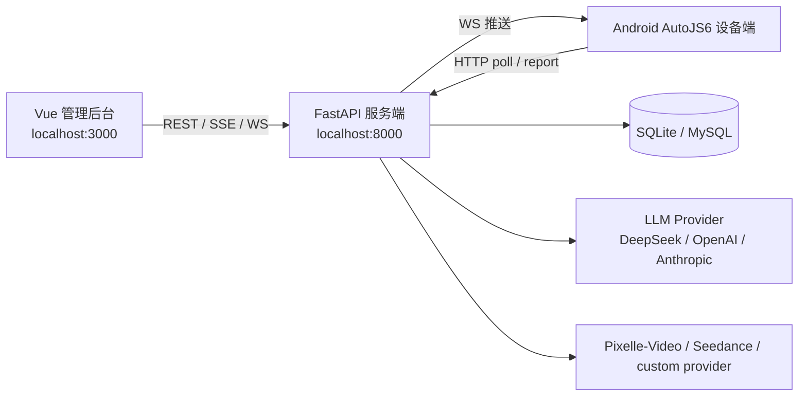

# dy_auto

抖音矩阵自动化运营与 AI 视频生产平台。

`dy_auto` 由三部分组成：运行在 Android/AutoJS6 上的设备端脚本、FastAPI 服务端、Vue 3 管理后台。项目覆盖账号与设备管理、任务调度、搜索采集、评论回复、关注/私信触达、数据统计，以及围绕 Pixelle-Video/Seedance 等 provider 的 AI 图像与视频生产控制链路。

> 合规提醒：本项目涉及平台自动化、账号运营、私信触达和外部 AI provider 调用。实际使用前应确认业务场景、平台规则、账号授权、数据处理和内容发布流程符合适用法律法规及目标平台规范。

## 核心能力

- **设备自动化执行**：AutoJS6 设备端通过 HTTP 轮询和 WebSocket 与服务端通信，执行搜索、采集、点赞、评论、关注、DM 等任务。
- **任务与频道调度**：以账号、设备、频道、关键词、任务链为核心对象，支持队列领取、执行上报、超时恢复、失败重试和统计归因。
- **UI 选择器与模板管理**：服务端下发不同平台版本、分辨率 profile 的 UI 选择器和模板图片，设备端按策略链匹配元素。
- **AI 运营内容生成**：支持 AI 评论分析、拟人回复、提示词模板、DM 序列生成、内容模板和模型配置。
- **AI 视频生产**：支持系列、剧集、角色、场景、导演分镜、视频流水线、Pixelle-Video 代理、图像创作、图像策略和视频审核。
- **生产控制平面**：视频生产链路包含 provider stage task、成本预留、并发保护、资产落库、AI/人工审核、最终审核和可修复错误提示。
- **管理后台**：Vue 3 单页应用提供运营、任务、数据、AI 视频和系统管理页面。

## 技术栈

| 层 | 技术 | 说明 |
| --- | --- | --- |
| 服务端 | Python 3.12+, FastAPI, SQLAlchemy, Pydantic v2, Alembic, httpx, WebSocket/SSE | REST API、设备调度、AI/provider 集成、数据库模型与迁移 |
| 前端 | Vue 3, Vue Router, Pinia, Vite, Tailwind CSS 4, Axios, Chart.js, Three.js | 管理后台、监控页、AI 视频工作台、审核页 |
| 设备端 | AutoJS6, Rhino ES5.1, Android UI Automator, images.findImage | Android 抖音自动化脚本，必须兼容 ES5.1 |
| 数据库 | SQLite 开发默认，MySQL 可通过 `DATABASE_URL` 切换 | SQLite 默认路径为 `server/app/data/dy_auto.db` |

## 架构概览



关键数据流：

```text
管理后台创建账号/频道/任务
  -> 服务端生成任务队列
  -> 设备端 poll 领取任务
  -> AutoJS 执行抖音页面操作
  -> 设备端 report 上报结果
  -> 服务端入库、统计、恢复或推进下一阶段
  -> 前端实时查看任务、设备、数据和审核状态
```

## 目录结构

```text
dy_auto/
├── device/                  # Android AutoJS6 设备端脚本
│   ├── main.js              # 设备端入口：配对、WS、轮询、任务主循环
│   ├── config.js            # 本地连接信息和服务端下发配置默认值
│   ├── core/                # API 客户端、任务执行、选择器、反检测、配对、悬浮窗
│   ├── handlers/            # nurture / reply-comment / search-* 等业务 handler
│   └── test/                # 设备端 Node 兼容单元测试和调试脚本
├── server/                  # FastAPI 服务端
│   ├── app/
│   │   ├── main.py          # FastAPI 入口、路由挂载、启动生命周期
│   │   ├── config.py        # 环境变量、AI 配置、Pixelle-Video 配置
│   │   ├── database.py      # DB engine/session/init_db
│   │   ├── db_models.py     # SQLAlchemy ORM 模型
│   │   ├── routers/         # REST API 路由
│   │   ├── services/        # 调度、AI、生产、审核、provider 等业务服务
│   │   └── data/            # SQLite DB、内置数据、agent 定义等
│   ├── alembic/             # 数据库迁移
│   ├── requirements.txt     # Python 依赖
│   └── tests/               # pytest 测试
├── web/                     # Vue 3 管理后台
│   ├── src/api/             # Axios API 客户端
│   ├── src/router/          # 页面路由
│   ├── src/views/           # 页面组件
│   ├── src/components/      # 通用、业务、资产、agency 组件
│   └── src/__tests__/       # Vitest 测试
├── docs/                    # ADR、规格、计划、报告、数据库结构文档
├── tools/                   # 本地辅助工具，如 EverCore memory helper
├── PROJECT-OVERVIEW.md      # 更详细的历史项目全景
├── CLAUDE.md                # 面向 AI coding agent 的项目约定
└── CHANGELOG.md             # 版本变更记录
```

## 快速开始

### 1. 准备环境

建议环境：

- Windows + PowerShell
- Python 3.12+
- Node.js 20+ / npm
- Android 设备或模拟器，安装 AutoJS6
- 可选：Pixelle-Video 或其他视频生成 provider

首次拉取后建议创建本地环境文件：

```powershell
Copy-Item .env.example .env
```

开发默认可以使用 SQLite。生产或多人环境应至少修改：

- `DEVICE_SECRET`
- `ADMIN_PASSWORD`
- `JWT_SECRET`
- `DATABASE_URL`
- AI/provider API key

### 2. 启动服务端

```powershell
cd server
python -m venv .venv
.\.venv\Scripts\Activate.ps1
pip install -r requirements.txt
python app/main.py
```

服务端默认监听：

- API: `http://localhost:8000`
- OpenAPI: `http://localhost:8000/docs`
- 基础健康检查: `GET http://localhost:8000/health`

服务端启动时会执行：

- Alembic migration 到 head
- `Base.metadata.create_all` 兜底建表
- SQLite 缺列轻量补齐
- 默认管理员账号 seed
- selector 描述和参考数据 seed

生产启动可使用：

```powershell
cd server
uvicorn app.main:app --host 0.0.0.0 --port 8000
```

### 3. 启动前端

```powershell
cd web
npm install
npm run dev
```

前端默认地址：

- Web: `http://localhost:3000`
- Vite dev server 会把 `/api` 和 WebSocket 请求代理到 `http://localhost:8000`
- 如需改后端地址，设置 `VITE_API_PROXY_TARGET`

```powershell
$env:VITE_API_PROXY_TARGET = "http://localhost:8000"
npm run dev
```

默认管理员账号来自环境变量：

- 用户名：`ADMIN_USERNAME`，默认 `admin`
- 密码：`ADMIN_PASSWORD`，默认 `admin123`

### 4. 运行设备端

设备端不是 Node.js 项目，运行环境是 Android AutoJS6 的 Rhino ES5.1。

基本流程：

1. 确保服务端可被手机访问，例如电脑局域网 IP `http://192.168.x.x:8000`。
2. 将 `device/` 脚本导入 AutoJS6，入口为 `device/main.js`。
3. 首次运行时设备端显示配对界面，输入服务端地址。
4. 在管理后台设备页面审批配对。
5. 配对成功后，设备端保存 `server_url`、`device_id`、`device_secret`，进入主循环。

设备端代码约束：

- 只能使用 `var`、`function`、CommonJS `require()` 和回调风格。
- 不要使用 `let`、`const`、箭头函数、Promise、模板字符串或其他 ES6+ 语法。
- 设备配置主要由服务端下发，`device/config.js` 只保留连接信息和默认值。

如需重新打包设备脚本：

```powershell
python .\tools\pack_device.py
```

输出文件为根目录 `device-script.zip`，也可用 `--output` 指定路径。打包入口会包含新增核心模块，排除测试和运行缓存，校验所有静态本地 `require()` 依赖，并生成带文件大小和 SHA-256 的 `device-update.json`。上传端拒绝不完整、路径不安全或校验不符的 ZIP；请上传此命令的输出，不要再上传手工拼装的增量包。

更新器先在项目内准备并校验完整版本，再原子切换 `main.js` 入口；复制失败时保持原有脚本和版本。配对信息仍由 AutoJS 本地存储保存，模板、日志等运行缓存不在更新包中。更新成功后仍需按原流程重启脚本，新版本才开始执行。

## 关键环境变量

| 变量 | 默认值 | 说明 |
| --- | --- | --- |
| `HOST` | `0.0.0.0` | 服务端监听地址 |
| `PORT` | `8000` | 服务端监听端口 |
| `DEBUG` | `true` | 调试模式 |
| `DATABASE_URL` | `sqlite:///server/app/data/dy_auto.db` | 数据库连接；生产可切 MySQL |
| `DEVICE_SECRET` | `change-me-to-a-random-string` | 设备配对/通信密钥，生产必须修改 |
| `ADMIN_USERNAME` | `admin` | 默认管理员用户名 |
| `ADMIN_PASSWORD` | `admin123` | 默认管理员密码，生产必须修改 |
| `JWT_SECRET` | `change-me-jwt-secret-key` | JWT 签名密钥，生产必须修改 |
| `JWT_EXPIRE_HOURS` | `24` | 登录 token 有效期 |
| `AI_API_KEY` | 空 | 默认 LLM API key |
| `AI_BASE_URL` | `https://api.deepseek.com` | 默认 LLM base URL |
| `AI_MODEL` | `deepseek-chat` | 默认 LLM 模型 |
| `AI_PROVIDER` | `deepseek` | LLM provider 标识 |
| `AI_MAX_RETRIES` | `3` | AI 请求重试次数 |
| `AI_THINKING` | `max` | thinking 级别：`disabled`/`low`/`medium`/`high`/`xhigh`/`max` |
| `PIXELLE_VIDEO_URL` | `http://localhost:8500` | Pixelle-Video 服务地址 |
| `PIXELLE_API_KEY` | 空 | Pixelle-Video API key |
| `PIXELLE_CONFIG_PATH` | `../Pixelle-Video/config.yaml` | Pixelle-Video 配置路径 |
| `DY_AUTO_PROVIDER_SUBMIT_WORKER_COUNT` | `1` | 真实付费 provider 提交安全闸；当前必须保持为 `1` |

## 服务端模块

主要 API 前缀：

| 前缀 | 模块 |
| --- | --- |
| `/api/auth` | 登录、设备登录、用户管理 |
| `/api/device` | 设备注册、配对、poll、report、选择器/模板同步 |
| `/api/devices` | 设备管理 |
| `/api/accounts`, `/api/account-groups` | 账号和账号分组 |
| `/api/tasks`, `/api/channels`, `/api/chains` | 任务、频道和任务链 |
| `/api/selectors` | UI 选择器管理 |
| `/api/content`, `/api/prompt-templates`, `/api/dm-sequences` | 内容、提示词、DM 序列 |
| `/api/data`, `/api/stats` | 数据中心和统计 |
| `/api/ai-models` | AI 模型配置 |
| `/api/characters`, `/api/scenes`, `/api/series`, `/api/director` | AI 视频资产、系列和导演分镜 |
| `/api/pipeline`, `/api/videos`, `/api/pixelle`, `/api/pixelle-proxy` | 视频流水线、视频管理和 Pixelle 代理 |
| `/api/video-production` | 视频生产 run、worker step、provider stage task、成本、审核 |
| `/api/image-creation`, `/api/image-production` | 图像创作与图像策略中心 |
| `/api/agency` | Agency console、专家运行时和自动修复链路 |
| `/api/system` | 系统健康与真实 provider readiness |

视频生产相关的核心服务：

- `provider_stage_executor.py`：provider 提交、同步、幂等、成本预留、并发保护。
- `provider_stage_task_service.py`：provider stage task 创建、claim、状态转换和 request hash。
- `provider_cost_reservation_service.py`：成本预留生命周期。
- `production_worker_service.py`：真实生产 worker step，连接 Pixelle stage client 和资产落库。
- `video_production_service.py`：阶段推进、资产审核、重生成、最终视频持久化。
- `production_gate_evaluator.py`、`video_production_readiness.py`：生产 gate 和修复提示。

## 前端页面

导航分为五类：

- **运营**：仪表盘、账号管理、账号分组、设备管理。
- **任务**：任务中心、任务链模板、链实例、选择器管理。
- **数据**：数据中心、数据统计。
- **AI 视频**：一句话成片、AI 视频工坊、图像创作、图像策略中心、系列管理、角色资产库、场景资产库、AI 模型配置、视频管理、提示词模板、AI 视频审查。
- **系统**：内容管理、DM 序列、系统字典、用户管理、系统设置。

动态页面包括：

- `/series/:id`
- `/series/:seriesId/agency-console`
- `/series/:seriesId/collection-builder`
- `/director/:seriesId/:episodeId`
- `/pipeline/:runId`
- `/video-production/:runId`

## 测试与验证

后端：

```powershell
cd server
pytest
```

单文件或单用例：

```powershell
cd server
pytest tests/test_device_endpoints.py -v
pytest tests/test_device_endpoints.py::test_register -v
```

前端：

```powershell
cd web
npx vitest
npm run build
```

设备端 Node 兼容测试示例：

```powershell
node device/test/nurture.node-test.js
node device/test/task-timeout.node-test.js
node device/test/human-input.node-test.js
```

常用健康检查：

```powershell
Invoke-RestMethod http://localhost:8000/health
```

登录后可访问真实 provider readiness：

```text
GET /api/system/health
```

该接口会检查视频生产关键表、provider capability、API key/base URL/model、estimated cost，以及 `DY_AUTO_PROVIDER_SUBMIT_WORKER_COUNT`。

## 开发约定

- 根目录 `AGENTS.md` 包含 Codex/EverCore 项目约束。
- `CLAUDE.md` 包含常用命令、架构说明和 coding agent 注意事项。
- 设备端必须保持 AutoJS6/Rhino ES5.1 兼容。
- 修改现有代码时保持小范围变更，不顺手重构无关模块。
- 涉及 bugfix 或业务行为变更时，优先补充可复现测试或覆盖关键状态转换。
- 已有工作区可能存在大量未提交改动；提交前应用 `git status` 和 `git diff` 明确本次改动边界。

## 数据库与迁移

- 默认 SQLite 数据库：`server/app/data/dy_auto.db`
- Alembic 配置：`server/alembic.ini`
- 迁移目录：`server/alembic/versions/`
- 启动时 `init_db()` 必须先成功执行 `alembic upgrade head`，再补齐仍由 ORM 管理的历史表和 SQLite 缺列。迁移失败会中止启动并保留错误，不再绕过失败继续运行。
- 本次审查修复的迁移顺序、旧库处理和验证边界见 [2026-11-05 修复与升级说明](docs/operations/2026-11-05-audit-repairs.md)。

手动迁移：

```powershell
cd server
alembic upgrade head
```

生产环境建议：

- 明确设置 `DATABASE_URL`。
- 在启用真实付费 provider 前先运行迁移。
- 保持 `DY_AUTO_PROVIDER_SUBMIT_WORKER_COUNT=1`，直到实现 DB-backed cross-process quota。
- 不要提交本地 SQLite 数据库、备份库、日志、输出视频或真实凭据。

## Pixelle-Video 与 provider 集成

当前项目把 Pixelle-Video/provider 接入作为生产链路的一环，而不是简单的同步视频生成调用：

1. 前端或服务端创建 video production run。
2. 生产计划拆分为 image generation、video generation、composition 等 stage。
3. worker 通过 `ProviderStageExecutor` 提交到 Pixelle stage API。
4. 请求携带 `provider_stage_task_id` 和 `provider_idempotency_key`。
5. 服务端同步 provider task 状态、记录成本、保存资产。
6. AI 审核和人工审核 gate 决定是否进入下一阶段。
7. 最终视频资产进入 final review。

相关配置：

- `PIXELLE_VIDEO_URL`
- `PIXELLE_API_KEY`
- `PIXELLE_CONFIG_PATH`
- 管理后台的 AI 模型配置和 provider capability

真实 provider 烟测脚本位于：

- `server/scripts/smoke_real_provider_video.py`
- `server/scripts/smoke_seedance_short_video.py`

运行前必须确认 API key、base URL、model capability、estimated cost 和 worker 安全闸已配置。

## 常见问题

### 前端请求后端失败

确认：

- 服务端已启动在 `http://localhost:8000`。
- Vite proxy 目标正确，必要时设置 `VITE_API_PROXY_TARGET`。
- 浏览器请求路径以 `/api` 开头时由 Vite 代理转发。

### 登录失败

确认：

- 数据库中已 seed 管理员用户。
- `.env` 中的 `ADMIN_USERNAME` / `ADMIN_PASSWORD` 与实际登录一致。
- 如果数据库已经存在用户，修改环境变量不会自动重置已有用户密码。

### 设备配对失败

确认：

- 手机能访问电脑局域网 IP 和端口，例如 `http://192.168.x.x:8000`。
- `DEVICE_SECRET` 与服务端一致。
- 管理后台已审批配对请求。
- 防火墙没有阻止 8000 端口。

### 设备脚本运行异常

确认：

- 设备端代码没有使用 ES6+ 语法。
- AutoJS6 权限、无障碍服务、悬浮窗权限已开启。
- 对应抖音版本和设备分辨率已有可用 selector/template。
- 可通过选择器管理或自动标定补充新分辨率素材。

### Pixelle-Video 调用失败

确认：

- `PIXELLE_VIDEO_URL` 指向正在运行的 Pixelle-Video 服务。
- provider API key、base URL、model name 和 capability 在 AI 模型配置中完整。
- `DY_AUTO_PROVIDER_SUBMIT_WORKER_COUNT=1`。
- `/api/system/health` 没有 migration、worker、capability 或 cost 阻塞项。

## 延伸文档

- [项目全景](PROJECT-OVERVIEW.md)
- [AI coding agent 约定](CLAUDE.md)
- [更新日志](CHANGELOG.md)
- [数据库结构](docs/database-schema.md)
- [ADR 索引](docs/adr/README.md)
- [视频生成设计](docs/superpowers/specs/2026-05-12-video-generation-design.md)
- [Pixelle stage gate 集成设计](docs/superpowers/specs/2026-05-25-dy-auto-pixelle-stage-gated-integration-design.md)
- [视频生产边界闭环设计](docs/superpowers/specs/2026-06-01-video-production-boundary-closure-design.md)
- [Agency 自动修复设计](docs/superpowers/specs/2026-06-03-agency-auto-repair-loop-design.md)
