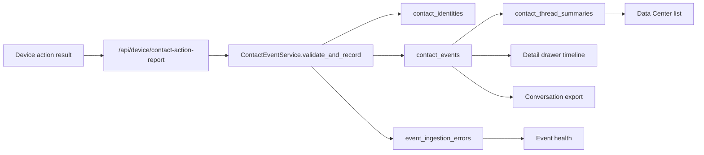

# DM Contact Event Timeline Implementation Plan

> **For agentic workers:** REQUIRED SUB-SKILL: Use superpowers:subagent-driven-development (recommended) or superpowers:executing-plans to implement this plan task-by-task. Steps use checkbox (`- [ ]`) syntax for tracking.

**Goal:** Replace the fragile private-message conversation summary with a unified target-contact event timeline so all sent/failed DM messages, replies, follows, and collected-contact facts are visible in Data Center, export, and diagnostics.

**Architecture:** `contact_events` is the single fact source. Device code reports action results; the backend validates and normalizes those reports through `ContactEventService`, resolves `contact_identity`, enforces `event_key` idempotency, records ingestion failures, and updates a rebuildable `contact_thread_summaries` read model. The frontend reads list/detail/export/health data through one shared filter contract.

**Tech Stack:** FastAPI, Pydantic v2, SQLAlchemy 2, SQLite, pytest, Vue 3, Vite, Vitest, AutoJS-compatible ES5 JavaScript.

---

## Assumptions

- Work is scoped to `D:\devWorkspace\jsProjects\dy_auto`.
- Do not import any plan or implementation detail from `F:\my_projects\xianyu\x_radar_backend`.
- Existing `Conversation` rows stay available as compatibility data, but new behavior must not treat `Conversation.last_dm_content`, `Conversation.total_dm_count`, or `Conversation.current_stage` as the source of truth.
- Existing `/api/device/dm-claim-recipient` can remain as a short-term recipient reservation endpoint, but every actual touch fact must be persisted as a `ContactEvent`.
- Schema creation relies on existing `Base.metadata.create_all()` plus the existing SQLite column migration helper; there is no Alembic migration tree in this repo today.
- Device JavaScript must remain ES5-compatible: use `var`, function expressions, and no optional chaining, destructuring, `let`, `const`, or arrow functions.

## Success Criteria

- A three-message DM sequence produces three timeline rows with correct order, content, timestamps, and sent/failed status.
- A failed second DM is visible as `dm_failed` and does not increment successful DM counts.
- Duplicate device reports return `duplicate` and do not create duplicate events or inflated summary counts.
- `reply_comment`, `search_dm`, `/collect-report`, and `/user-profile` all create events through the same service.
- Data Center list, detail drawer, export, and health view use the same filter schema.
- Backfilled history is marked as derived and incomplete; missing historical DM 1/2/3 rows are not invented.
- Event ingestion failures are visible through `event_ingestion_errors` and the health API.
- Backend pytest, frontend Vitest, and `npm run build` pass.

## File Structure

- Create `server/app/services/contact_event_service.py`: identity resolution, event payload validation, authorization, idempotent event insertion, ingestion error recording, summary updates, timeline querying, health aggregation, and backfill helpers.
- Create `server/tests/test_contact_event_service.py`: service-level tests for event creation, duplicates, low-confidence identity, invalid payload, failed-event recording, and summary updates.
- Create `server/tests/test_contact_event_device_api.py`: device-facing API tests for `/contact-action-report`, `/dm-send-report` compatibility, auth, duplicate reports, and unauthorized task/device/account combinations.
- Create `server/tests/test_contact_event_data_api.py`: Data Center list/detail/health API tests using shared filters and non-admin scoping.
- Create `server/tests/test_contact_event_backfill.py`: idempotent historical backfill tests.
- Modify `server/app/db_models.py`: add `ContactIdentity`, `ContactEvent`, `ContactThreadSummary`, and `EventIngestionError`.
- Modify `server/tests/conftest.py`: clean contact-event tables before `Task`, `Account`, and `Device` to avoid FK failures.
- Modify `server/app/models.py`: add Pydantic request/response contracts for action reports, timeline queries, and health responses.
- Modify `server/app/routers/device.py`: add `/api/device/contact-action-report`, route `/dm-send-report` through the same service, and call the service after collection saves.
- Modify `server/app/routers/data.py`: list conversations from `contact_thread_summaries`, add detail and health endpoints, and export timeline summaries with the same filters.
- Create `scripts/backfill_contact_events.py`: idempotent CLI wrapper around service backfill.
- Modify `device/core/api-client.js`: add `reportContactAction()` and update `reportDMSend()` payload support.
- Modify `device/handlers/search-base.js`: return per-message send result objects from `_sendMessageSequence()`.
- Modify `device/handlers/reply-comment.js`: report each DM sequence item individually and report reply/follow touch events where those actions happen.
- Modify `device/handlers/search-dm.js`: claim or resolve recipient identity and report each sent/failed DM sequence item.
- Modify `web/src/api/data.js`: add `getConversationTimeline()` and `getContactEventHealth()`.
- Modify `web/src/views/DataCenterPage.vue`: add conversation detail drawer, timeline rendering, confidence/history/error markers, and health panel.
- Modify `web/src/__tests__/data-center-export.test.js`: assert conversation export includes timeline filters.
- Create `web/src/__tests__/data-center-contact-timeline.test.js`: list/detail/health UI tests.

## Data Flow



## Engineering Review Additions

### Phased Execution and Merge Gates

The full data model should be designed once, but implementation must merge in phases. Do not treat the 13 tasks as one all-or-nothing batch.

| Phase | Scope | Tasks | Merge Gate |
|-------|-------|-------|------------|
| Phase 0: Fact schema and contracts | Add `ContactIdentity`, `ContactEvent`, `ContactThreadSummary`, and `EventIngestionError`; add Pydantic contracts including fields needed by later collect/profile/backfill work. | Tasks 1-3 | Schema, contract, and service tests pass. No frontend/device behavior changes yet. |
| Phase 1: DM/reply truth path | Route `dm-send-report`, new `contact-action-report`, `reply_comment`, `search_dm`, and Data Center list/detail/export through contact events. This phase fixes the three-message DM visibility problem. | Tasks 4, DM/reply portions of 5, 6, 8, 9, 10, 11, 12 | A 3-message sequence with one failure appears correctly in list, drawer, and export; duplicate reports do not inflate counts; backend focused tests, frontend focused tests, device syntax checks, and web build pass. |
| Phase 2: Secondary sources and diagnostics | Add collect-report/user-profile event routing, health endpoint/UI, and backfill script. | Remaining portions of Tasks 5, 6, 7, 12, 13 | Collection/profile events appear in timelines, backfill is idempotent and marks history incomplete, health reports ingestion failures without showing fake zeros, and full focused suite passes. |

Execution rules:

- Phase 0 must land before any device or frontend changes.
- Phase 1 must remain useful without Phase 2. If health is not implemented yet, the Data Center must hide the health strip or show the explicit `事件健康信息加载失败` state; it must not show zeros from a missing endpoint.
- Phase 2 must not alter Phase 1 event keys for DM/reply events. Event idempotency is a contract once Phase 1 lands.
- Each phase should be committed separately. Do not stage unrelated dirty worktree changes with these commits.

### Transaction Boundary Decision

`ContactEventService` must not hide success commits inside helper methods:

- `ContactEventService.record_action()` owns validation, identity resolution, event insertion, summary updates, and `flush()` only.
- API routes, CLI scripts, and backfill orchestration own success `commit()` and failure `rollback()`.
- Ingestion error persistence uses one explicit helper: `record_ingestion_error_after_rollback()`. Callers invoke it only after rolling back the failed unit of work. This helper is the only service method allowed to open and commit the small error-recording transaction.
- This keeps `ContactEvent + ContactThreadSummary` atomic on success, keeps error recording visible on failure, and lets future batch/backfill code group many events in one caller-owned transaction.

## Design Review Additions

### Visual Reference

Use this approved design baseline for the Data Center contact timeline UI:

| Screen/Section | Mockup Path | Direction | Notes |
|----------------|-------------|-----------|-------|
| Data Center contact timeline | `C:\Users\HNXE\.gstack\projects\dy_auto\designs\contact-event-timeline-20260602\wireframe.html` | Dense operational admin view with conversation list, lightweight diagnostics, and right-side touch timeline drawer | Generated as HTML wireframe because gstack designer PNG generation was unavailable without an OpenAI API key. |

### What Already Exists

- Reuse `web/src/components/assets/AssetDetailDrawer.vue` for the contact timeline drawer instead of hand-writing a fixed overlay. It already provides HeadlessUI Dialog behavior, transitions, focus handling, backdrop, ARIA labels, and a consistent close button.
- Reuse `web/src/components/ui/AppBadge.vue` for low-confidence, history-incomplete, failure, and success markers where possible.
- Reuse the existing Data Center card density, dark slate/cyan visual language, filters, and export placement. Do not introduce a marketing-style dashboard or decorative hero.

### Information Architecture

The conversations tab must preserve this first-screen hierarchy:

1. Primary: current filtered conversation/contact list. Users came here to find whether a target user was actually touched and how many DM messages succeeded or failed.
2. Secondary: selected contact touch timeline in the right-side drawer. It explains the selected row without replacing the list context.
3. Tertiary: event health diagnostics. This exists to explain missing/failed event ingestion and must not dominate routine scanning.

Desktop layout:

```text
+--------------------------------------------------------------------------+
| Data Center title + export                                                |
+--------------------------------------------------------------------------+
| Tabs                                                                      |
+--------------------------------------------------------------------------+
| Filters: search | account | stage | status | date | export                |
+--------------------------------------------------------------------------+
| Compact event health strip, max 20% of first viewport height              |
+--------------------------------------+-----------------------------------+
| Conversation/contact list             | Right-side timeline drawer        |
| - identity + external id              | - identity summary                |
| - stage/status/confidence markers     | - DM sent/failed/event counts     |
| - latest touch summary                | - ordered touch timeline          |
| - DM sent/failed count + last time    | - failure and data-quality notes  |
+--------------------------------------+-----------------------------------+
```

The event health strip must stay compact: one row on desktop, two rows at tablet width, and no more than 20% of the first viewport height. It should read as diagnostics, not executive KPI cards.

### Interaction States

Every contact timeline UI area must specify what the user sees in each state:

| Feature | Loading | Empty | Error | Success | Partial |
|---------|---------|-------|-------|---------|---------|
| Conversation list | Keep filters visible and show a compact spinner in the list area. | Use the existing empty-state pattern with message: `暂无符合筛选条件的私信会话`; primary action is clearing filters. | Show `加载会话失败，请重试` in the list area and keep current filters; do not clear previous list until a successful refresh replaces it. | Show filtered contact/conversation rows with DM sent/failed count, latest touch, stage, status, confidence markers, and last event time. | Rows can show `历史不完整`, `低置信`, or `事件写入异常` badges while still remaining selectable. |
| Event health strip | Reserve the same strip height and show four muted skeleton/placeholder cells. | Show zeros only when the API returns valid zero counts. | Collapse to a one-line warning: `事件健康信息加载失败`; do not display zeros because that implies there are no failures. | Show `触达事件`, `写入失败`, `低置信身份`, and `DM 成功 / 失败`. | Show available counts and mark unavailable fields as `-`; do not hide the strip if only recent errors fail to load. |
| Detail drawer | Open immediately with selected contact header and skeleton timeline rows. | Show `暂无触达事件` inside the drawer, with the contact identity still visible. | Keep the drawer open, keep the selected contact header, and show `触达时间线加载失败，请重试`; do not close the drawer or clear the list. | Show summary counts and ordered timeline events. | Show data-quality explanation blocks when identity is low confidence, history was backfilled, or event writes failed. |
| Timeline event row | Use fixed row spacing so late content does not shift the drawer header. | Not applicable per row. | Failed events render as timeline facts with a rose marker and `failure_reason`; they are not treated as UI load errors. | DM rows emphasize message order and content; collection/reply/follow rows remain compact context. | Missing content falls back to failure reason, then `-`; derived history rows show `历史摘要` and `history_incomplete`. |
| Export button | Disable button and show exporting label while preserving current filter controls. | If current filters return zero rows, export returns a valid empty sheet with headers. | Show toast `导出失败: <reason>` and keep current page state. | Download file using the current tab, page/all selection, and shared filters. | Export includes low-confidence/history-incomplete/write-error columns so users understand incomplete data outside the UI. |

### User Journey Storyboard

This UI is an operations trust tool. The user is not trying to browse a generic event log; they are trying to answer: `这个目标用户到底触达了吗？三条私信哪条成功、哪条失败？这份数据可信吗？`

| Step | User Does | User Feels | Plan Must Support |
|------|-----------|------------|-------------------|
| 1 | Opens Data Center > Private Conversations | Wants a fast answer, not another dashboard | Conversation list is the largest first-screen area; health is compact diagnostics. |
| 2 | Scans current filtered results | Looks for anomalies: failed DM, low-confidence identity, history gaps | Each row shows nickname, external ID, stage, latest touch, DM sent/failed count, last event time, and small data-quality markers. |
| 3 | Clicks a suspicious contact | Needs proof of what happened | Drawer opens without losing list context; header repeats identity and confidence; summary shows DM success/failure counts. |
| 4 | Reads timeline | Wants sequence truth, especially DM 1/2/3 | DM events use message order labels; failed events show named reason and do not look like delivered messages. |
| 5 | Exports filtered data | Needs the spreadsheet to match what the page showed | Export uses the same filters and includes timeline, low-confidence, history-incomplete, and event-write issue fields. |
| 6 | Comes back weeks later | Needs confidence that old rows are not pretending to be complete | Backfilled history is marked as `历史不完整`; old summaries are never visually equivalent to complete event timelines. |

Time horizon:

- First 5 seconds: the user can see which rows are normal, failed, low-confidence, or historically incomplete.
- First 5 minutes: the user can open one row, verify the exact DM sequence, and understand why a message is missing.
- Long-term trust: page, detail drawer, and export tell the same story, with incomplete data labeled instead of hidden.

### App UI Hard Rules

This screen is an operational workspace, not a marketing page or executive dashboard.

- Do not add hero sections, decorative gradients, floating graphics, marketing copy, or large KPI cards.
- The health area is a compact diagnostic strip. It must not read as the primary content or push the conversation list below the first viewport.
- Conversation cards are allowed because each card is a selectable conversation/contact object. Do not add decorative cards around sections, filters, drawer content, or timeline groups.
- Do not put cards inside cards. Drawer header, summary counts, and timeline rows are separate layout regions, not nested card stacks.
- Use a calm dark slate surface with restrained status colors: cyan for active/primary, emerald for success, amber for low-confidence/history warnings, rose for failures.
- Keep dominant radius at 8px or less.
- Show at most three status markers on a conversation row. If more data-quality flags exist, show the most severe three in this order: event write issue, DM failed, low-confidence identity, history incomplete. The drawer can explain the full set.
- Timeline rows must be visually differentiated by event role: DM rows have stronger emphasis, failure rows use rose marker and reason text, collection/reply/follow rows remain compact context.
- Avoid generic labels such as `Events` when a more precise label fits. Prefer `触达事件`, `写入失败`, `低置信身份`, `DM 成功 / 失败`.

### Responsive and Accessibility Requirements

The implementation must pass these layout and accessibility checks:

- Desktop (`>= 1024px`): preserve the existing Data Center list-first workflow. The health strip is one compact row above the conversation list; the timeline opens in the existing right-side `AssetDetailDrawer`.
- Tablet (`640px` to `1023px`): the health strip becomes two columns, and the drawer continues using `w-full max-w-2xl` so it can occupy the available width without squeezing the timeline content.
- Mobile (`< 640px`): the drawer is effectively full-screen width, summary counts stack to avoid clipped labels, and the conversation list remains reachable after closing the drawer.
- Conversation rows must use a native `<button type="button">`, not a clickable `div`, with `text-left`, a visible `focus-visible` ring, and a minimum tap target height of `44px`.
- Status markers must always include visible text. Do not rely on hover-only color, tooltip-only explanation, or icon-only state markers.
- Timeline rows must be rendered as an ordered list (`ol > li`) in chronological display order so screen readers announce the sequence naturally.
- Failure and warning states must use both text and color. Rose/amber color alone is not enough to communicate state.
- The drawer close path must remain the existing `AssetDetailDrawer` behavior: close button, backdrop, Escape key, focus trap, and focus return are provided by HeadlessUI and must not be bypassed.
- Long nicknames, external IDs, message content, and failure reasons must truncate or wrap inside their containers; they must not widen the drawer or overlap adjacent UI.

### Timeline Scope Decision

The detail drawer must make the event scope explicit:

- Default scope is `当前筛选`: the timeline request includes the current Data Center filters, especially `date_from` and `date_to`, so the drawer initially matches the list context the user clicked from.
- The drawer includes a compact segmented control with `当前筛选` and `全部历史`.
- Switching to `全部历史` keeps the selected contact identity fixed but removes date range filtering from the timeline event query. It does not change the conversation list filters or export filters.
- The drawer top area shows a scope hint: `当前筛选范围` when filtered, and `全部历史` when all history is selected.
- Empty state copy must include the scope: `当前筛选范围内暂无触达事件` or `暂无触达事件`.
- This decision exists to prevent the old failure mode where a user sent three DM messages but only part of the sequence appeared without explanation.

---

### Task 1: Add Contact Event Schema

**Files:**
- Modify: `server/app/db_models.py`
- Modify: `server/tests/conftest.py`
- Create: `server/tests/test_contact_event_models.py`

- [ ] **Step 1: Write the failing schema test**

Create `server/tests/test_contact_event_models.py`:

```python
from datetime import datetime

from sqlalchemy.exc import IntegrityError

from app.db_models import (
    Account,
    ContactEvent,
    ContactIdentity,
    ContactThreadSummary,
    Device,
    EventIngestionError,
    Task,
)


def _seed_account_device_task(db):
    account = Account(id="acc-contact-schema", nickname="schema account", douyin_id="acc_dy")
    device = Device(
        id="dev-contact-schema",
        name="schema device",
        device_secret="schema-secret",
        bound_account_id=account.id,
    )
    task = Task(
        id="task-contact-schema",
        type="reply_comment",
        account_id=account.id,
        device_id=device.id,
        status="running",
        params={"keyword": "travel"},
    )
    db.add_all([account, device, task])
    db.commit()
    return account, device, task


def test_contact_event_schema_persists_identity_event_summary_and_error(db):
    account, device, task = _seed_account_device_task(db)
    identity = ContactIdentity(
        id="identity-schema",
        platform="douyin",
        identity_key="douyin:dy-001",
        stable_external_id="dy-001",
        nickname="target user",
        confidence="high",
    )
    db.add(identity)
    db.flush()

    event = ContactEvent(
        id="event-schema",
        event_key="task-contact-schema:dm_sent:identity-schema:1:1",
        contact_identity_id=identity.id,
        account_id=account.id,
        device_id=device.id,
        task_id=task.id,
        event_type="dm_sent",
        source_path="reply_comment",
        status="sent",
        content="first message",
        message_order=1,
        sequence_total=3,
        source="device",
        occurred_at=datetime(2026, 6, 2, 10, 0, 0),
    )
    summary = ContactThreadSummary(
        id="summary-schema",
        contact_identity_id=identity.id,
        account_id=account.id,
        latest_event_type="dm_sent",
        latest_event_content="first message",
        dm_sent_count=1,
        last_event_at=datetime(2026, 6, 2, 10, 0, 0),
    )
    error = EventIngestionError(
        id="error-schema",
        event_key="bad-key",
        account_id=account.id,
        device_id=device.id,
        task_id=task.id,
        action_type="dm",
        source_path="reply_comment",
        error_name="InvalidContactEventPayload",
        raw_payload={"task_id": task.id},
        field_errors={"content": "required"},
    )
    db.add_all([event, summary, error])
    db.commit()

    assert db.query(ContactIdentity).count() == 1
    assert db.query(ContactEvent).count() == 1
    assert db.query(ContactThreadSummary).count() == 1
    assert db.query(EventIngestionError).count() == 1


def test_contact_event_key_is_unique(db):
    account, device, task = _seed_account_device_task(db)
    identity = ContactIdentity(
        platform="douyin",
        identity_key="douyin:dy-unique",
        stable_external_id="dy-unique",
        nickname="target user",
        confidence="high",
    )
    db.add(identity)
    db.flush()

    first = ContactEvent(
        event_key="duplicate-key",
        contact_identity_id=identity.id,
        account_id=account.id,
        device_id=device.id,
        task_id=task.id,
        event_type="dm_sent",
        source_path="reply_comment",
        status="sent",
        source="device",
        occurred_at=datetime(2026, 6, 2, 10, 0, 0),
    )
    second = ContactEvent(
        event_key="duplicate-key",
        contact_identity_id=identity.id,
        account_id=account.id,
        device_id=device.id,
        task_id=task.id,
        event_type="dm_sent",
        source_path="reply_comment",
        status="sent",
        source="device",
        occurred_at=datetime(2026, 6, 2, 10, 1, 0),
    )
    db.add(first)
    db.commit()
    db.add(second)

    try:
        db.commit()
        committed = True
    except IntegrityError:
        db.rollback()
        committed = False

    assert committed is False
```

- [ ] **Step 2: Run the schema test and verify it fails**

Run:

```powershell
python -m pytest server/tests/test_contact_event_models.py -q
```

Expected: FAIL because `ContactIdentity`, `ContactEvent`, `ContactThreadSummary`, and `EventIngestionError` are not defined.

- [ ] **Step 3: Add SQLAlchemy models**

Modify `server/app/db_models.py` after `Conversation`:

```python
class ContactIdentity(Base):
    """Target user identity for contact timelines."""
    __tablename__ = "contact_identities"
    __table_args__ = (
        UniqueConstraint("platform", "identity_key", name="uq_contact_identity_platform_key"),
        Index("ix_contact_identities_platform_confidence", "platform", "confidence"),
        Index("ix_contact_identities_nickname", "nickname"),
    )

    id = Column(String(36), primary_key=True, default=_uuid)
    platform = Column(String(30), nullable=False, default="douyin")
    identity_key = Column(String(255), nullable=False)
    stable_external_id = Column(String(200), nullable=True)
    nickname = Column(String(100), nullable=False, default="")
    profile_url = Column(Text, nullable=True)
    fallback_key = Column(String(255), nullable=True)
    fallback_reason = Column(String(200), nullable=True)
    confidence = Column(String(20), nullable=False, default="low")
    created_at = Column(DateTime, nullable=False, default=lambda: bj_now())
    updated_at = Column(DateTime, nullable=False, default=lambda: bj_now(), onupdate=lambda: bj_now())


class ContactEvent(Base):
    """Single immutable touch fact for a target contact."""
    __tablename__ = "contact_events"
    __table_args__ = (
        UniqueConstraint("event_key", name="uq_contact_events_event_key"),
        Index("ix_contact_events_identity_time", "contact_identity_id", "occurred_at"),
        Index("ix_contact_events_account_time", "account_id", "occurred_at"),
        Index("ix_contact_events_task_type", "task_id", "event_type"),
        Index("ix_contact_events_source_type", "source_path", "event_type"),
        Index("ix_contact_events_status", "status"),
    )

    id = Column(String(36), primary_key=True, default=_uuid)
    event_key = Column(String(300), nullable=False)
    contact_identity_id = Column(String(36), ForeignKey("contact_identities.id"), nullable=False)
    account_id = Column(String(36), ForeignKey("accounts.id"), nullable=False)
    device_id = Column(String(36), ForeignKey("devices.id"), nullable=True)
    task_id = Column(String(36), ForeignKey("tasks.id"), nullable=True)
    conversation_id = Column(String(36), ForeignKey("conversations.id"), nullable=True)
    event_type = Column(String(40), nullable=False)
    source_path = Column(String(40), nullable=False)
    status = Column(String(20), nullable=False, default="sent")
    keyword = Column(String(200), nullable=True)
    content = Column(Text, nullable=True)
    message_order = Column(Integer, nullable=True)
    sequence_total = Column(Integer, nullable=True)
    template_id = Column(String(36), nullable=True)
    template_name = Column(String(100), nullable=True)
    failure_reason = Column(Text, nullable=True)
    source = Column(String(20), nullable=False, default="device")
    history_incomplete = Column(Boolean, nullable=False, default=False)
    raw_payload = Column(JSON, nullable=True, default=dict)
    occurred_at = Column(DateTime, nullable=False, default=lambda: bj_now())
    created_at = Column(DateTime, nullable=False, default=lambda: bj_now())

    contact_identity = relationship("ContactIdentity")
    account = relationship("Account")
    device = relationship("Device")
    task = relationship("Task")
    conversation = relationship("Conversation")


class ContactThreadSummary(Base):
    """Rebuildable list read model derived from contact_events."""
    __tablename__ = "contact_thread_summaries"
    __table_args__ = (
        UniqueConstraint("account_id", "contact_identity_id", name="uq_contact_thread_account_identity"),
        Index("ix_contact_thread_account_updated", "account_id", "updated_at"),
        Index("ix_contact_thread_task", "task_id"),
        Index("ix_contact_thread_stage", "current_stage"),
        Index("ix_contact_thread_status", "status"),
        Index("ix_contact_thread_confidence", "confidence"),
    )

    id = Column(String(36), primary_key=True, default=_uuid)
    contact_identity_id = Column(String(36), ForeignKey("contact_identities.id"), nullable=False)
    account_id = Column(String(36), ForeignKey("accounts.id"), nullable=False)
    device_id = Column(String(36), ForeignKey("devices.id"), nullable=True)
    task_id = Column(String(36), ForeignKey("tasks.id"), nullable=True)
    conversation_id = Column(String(36), ForeignKey("conversations.id"), nullable=True)
    keyword = Column(String(200), nullable=True)
    recipient_nickname = Column(String(100), nullable=False, default="")
    recipient_external_id = Column(String(200), nullable=True)
    confidence = Column(String(20), nullable=False, default="low")
    current_stage = Column(String(20), nullable=False, default="qualifying")
    status = Column(String(20), nullable=False, default="active")
    latest_event_type = Column(String(40), nullable=True)
    latest_event_content = Column(Text, nullable=True)
    last_event_at = Column(DateTime, nullable=True)
    dm_sent_count = Column(Integer, nullable=False, default=0)
    dm_failed_count = Column(Integer, nullable=False, default=0)
    event_count = Column(Integer, nullable=False, default=0)
    has_low_confidence_identity = Column(Boolean, nullable=False, default=False)
    history_incomplete = Column(Boolean, nullable=False, default=False)
    has_ingestion_error = Column(Boolean, nullable=False, default=False)
    created_at = Column(DateTime, nullable=False, default=lambda: bj_now())
    updated_at = Column(DateTime, nullable=False, default=lambda: bj_now(), onupdate=lambda: bj_now())

    contact_identity = relationship("ContactIdentity")
    account = relationship("Account")
    device = relationship("Device")
    task = relationship("Task")
    conversation = relationship("Conversation")


class EventIngestionError(Base):
    """Visible record for action reports that could not become contact_events."""
    __tablename__ = "event_ingestion_errors"
    __table_args__ = (
        Index("ix_event_ingestion_errors_task", "task_id"),
        Index("ix_event_ingestion_errors_created", "created_at"),
        Index("ix_event_ingestion_errors_retry", "retry_status"),
        Index("ix_event_ingestion_errors_source", "source_path"),
    )

    id = Column(String(36), primary_key=True, default=_uuid)
    event_key = Column(String(300), nullable=True)
    contact_identity_id = Column(String(36), ForeignKey("contact_identities.id"), nullable=True)
    account_id = Column(String(36), ForeignKey("accounts.id"), nullable=True)
    device_id = Column(String(36), ForeignKey("devices.id"), nullable=True)
    task_id = Column(String(36), ForeignKey("tasks.id"), nullable=True)
    action_type = Column(String(40), nullable=True)
    source_path = Column(String(40), nullable=True)
    error_name = Column(String(100), nullable=False)
    field_errors = Column(JSON, nullable=True, default=dict)
    raw_payload = Column(JSON, nullable=True, default=dict)
    retry_status = Column(String(20), nullable=False, default="recorded")
    created_at = Column(DateTime, nullable=False, default=lambda: bj_now())

    contact_identity = relationship("ContactIdentity")
    account = relationship("Account")
    device = relationship("Device")
    task = relationship("Task")
```

- [ ] **Step 4: Add contact tables to test cleanup**

Modify `server/tests/conftest.py` imports to include the new models, and put the contact-event tables at the beginning of `_CLEANUP_TABLES`:

```python
from app.db_models import Base, Task, ChainInstance, DailyStats, Account, AccountGroup, AccountGroupMember, Channel, ChannelItem, Character, Scene, Series, Episode, PipelineRun, GeneratedVideo, AuditReport, ReferenceData, AIModel, User, VideoProductionRun, VideoProductionAsset, VideoReviewRecord, ImageProductionPolicyVersion, ImageProductionStrategy, ImageProductionStrategyVersion, ImageSelectionPreview, ImageCreationTask, ImageCreationAsset, ImageProductionCostEvent, ImageProductionAbAttempt, ImageProductionAbGroup, ImageProductionMetric, ImageCreationReviewRecord, AgencyExpertInvocation, ProductionAuditEvent, ProductionCostEvent, ProductionJob, ProductionSegment, ProductionShot, ProductionScene, ProductionEpisode, ProductionPlanVersion, ProductionPlan, VideoCollection, ContactEvent, ContactThreadSummary, EventIngestionError, ContactIdentity, series_characters, series_scenes
```

```python
_CLEANUP_TABLES = [
    EventIngestionError, ContactEvent, ContactThreadSummary, ContactIdentity,
    Task, DailyStats, AccountGroupMember, AccountGroup, ChainInstance,
    ChannelItem, Channel, ReferenceData,
    ImageCreationReviewRecord, ImageProductionAbAttempt, ImageProductionAbGroup,
    ImageProductionMetric, ImageProductionCostEvent, ImageCreationAsset, ImageCreationTask,
    ImageSelectionPreview, ImageProductionStrategyVersion,
    ImageProductionStrategy, ImageProductionPolicyVersion,
    AIModel,
    VideoReviewRecord, VideoProductionAsset, AgencyExpertInvocation, ProductionAuditEvent, VideoProductionRun,
    ProductionCostEvent, ProductionJob, ProductionSegment, ProductionShot,
    ProductionScene, ProductionEpisode, ProductionPlanVersion, VideoCollection,
    ProductionPlan, AuditReport, GeneratedVideo, PipelineRun, Episode,
]
```

- [ ] **Step 5: Run the schema test and commit**

Run:

```powershell
python -m pytest server/tests/test_contact_event_models.py -q
```

Expected: PASS.

Commit:

```powershell
git add server/app/db_models.py server/tests/conftest.py server/tests/test_contact_event_models.py
git commit -m "feat: add contact event schema"
```

---

### Task 2: Add Pydantic Contracts

**Files:**
- Modify: `server/app/models.py`
- Create: `server/tests/test_contact_event_contracts.py`

- [ ] **Step 1: Write failing contract tests**

Create `server/tests/test_contact_event_contracts.py`:

```python
import pytest
from pydantic import ValidationError

from app.models import ContactActionReportRequest, ContactTimelineFilter


def test_contact_action_report_accepts_dm_sequence_item():
    request = ContactActionReportRequest.model_validate({
        "task_id": "task-1",
        "account_id": "acc-1",
        "action_type": "dm",
        "source_path": "reply_comment",
        "status": "sent",
        "target": {
            "platform": "douyin",
            "stable_external_id": "dy-001",
            "nickname": "target user",
        },
        "content": "hello",
        "message_order": 2,
        "sequence_total": 3,
        "event_key": "task-1:dm:dy-001:2:1",
    })

    assert request.action_type == "dm"
    assert request.message_order == 2
    assert request.target.confidence_hint is None


def test_contact_action_report_rejects_invalid_status():
    with pytest.raises(ValidationError):
        ContactActionReportRequest.model_validate({
            "task_id": "task-1",
            "account_id": "acc-1",
            "action_type": "dm",
            "source_path": "reply_comment",
            "status": "maybe",
            "target": {"nickname": "target user"},
        })


def test_contact_timeline_filter_normalizes_limit():
    filters = ContactTimelineFilter(limit=500)
    assert filters.limit == 100


def test_contact_timeline_filter_rejects_invalid_scope():
    with pytest.raises(ValidationError):
        ContactTimelineFilter(timeline_scope="recent")
```

- [ ] **Step 2: Run contract tests and verify failure**

Run:

```powershell
python -m pytest server/tests/test_contact_event_contracts.py -q
```

Expected: FAIL because the contract classes do not exist.

- [ ] **Step 3: Add contracts**

Modify `server/app/models.py` after the existing DM conversation models:

```python
class ContactTargetPayload(BaseModel):
    platform: str = "douyin"
    stable_external_id: str | None = None
    nickname: str = ""
    profile_url: str | None = None
    fallback_key: str | None = None
    fallback_reason: str | None = None
    confidence_hint: str | None = None


class ContactActionReportRequest(BaseModel):
    task_id: str
    account_id: str
    action_type: str
    source_path: str
    status: str
    target: ContactTargetPayload
    event_key: str | None = None
    conversation_id: str | None = None
    keyword: str | None = None
    stage: str = "qualifying"
    intent: str | None = None
    content: str | None = None
    message_order: int | None = None
    sequence_total: int | None = None
    template_id: str | None = None
    template_name: str | None = None
    failure_reason: str | None = None
    occurred_at: datetime | None = None
    raw_context: dict[str, Any] = Field(default_factory=dict)

    @model_validator(mode="after")
    def validate_action_report(self):
        allowed_actions = {
            "dm", "reply", "follow", "user_collected", "comment_collected",
        }
        allowed_sources = {
            "reply_comment", "search_dm", "collect_report", "user_profile", "backfill",
        }
        allowed_status = {"sent", "failed", "succeeded", "collected"}
        if self.action_type not in allowed_actions:
            raise ValueError("action_type must be one of dm, reply, follow, user_collected, comment_collected")
        if self.source_path not in allowed_sources:
            raise ValueError("source_path must be one of reply_comment, search_dm, collect_report, user_profile, backfill")
        if self.status not in allowed_status:
            raise ValueError("status must be one of sent, failed, succeeded, collected")
        if self.action_type == "dm":
            if self.message_order is None or self.message_order < 1:
                raise ValueError("message_order is required for dm events and must be >= 1")
            if self.sequence_total is not None and self.sequence_total < self.message_order:
                raise ValueError("sequence_total must be >= message_order")
        if self.status == "failed" and not self.failure_reason:
            raise ValueError("failure_reason is required when status=failed")
        if self.action_type in {"dm", "reply"} and self.status != "failed" and not self.content:
            raise ValueError("content is required for successful dm and reply events")
        return self


class ContactActionReportResponse(BaseModel):
    status: str
    event_id: str | None = None
    event_key: str | None = None
    contact_identity_id: str | None = None
    duplicate: bool = False
    error_id: str | None = None


class ContactTimelineFilter(BaseModel):
    account_id: str | None = None
    device_id: str | None = None
    task_id: str | None = None
    keyword: str | None = None
    contact_query: str | None = None
    event_type: str | None = None
    status: str | None = None
    confidence: str | None = None
    source_path: str | None = None
    date_from: str | None = None
    date_to: str | None = None
    timeline_scope: str = "filtered"
    skip: int = 0
    limit: int = 50

    @model_validator(mode="after")
    def clamp_pagination(self):
        if self.timeline_scope not in {"filtered", "all"}:
            raise ValueError("timeline_scope must be filtered or all")
        if self.skip < 0:
            self.skip = 0
        if self.limit < 1:
            self.limit = 1
        if self.limit > 100:
            self.limit = 100
        return self
```

- [ ] **Step 4: Run contract tests and commit**

Run:

```powershell
python -m pytest server/tests/test_contact_event_contracts.py -q
```

Expected: PASS.

Commit:

```powershell
git add server/app/models.py server/tests/test_contact_event_contracts.py
git commit -m "feat: add contact event contracts"
```

---

### Task 3: Build ContactEventService Core

**Files:**
- Create: `server/app/services/contact_event_service.py`
- Create: `server/tests/test_contact_event_service.py`

- [ ] **Step 1: Write failing service tests**

Create `server/tests/test_contact_event_service.py` with these tests:

```python
from datetime import datetime

import pytest

from app.db_models import (
    Account,
    ContactEvent,
    ContactIdentity,
    ContactThreadSummary,
    Device,
    EventIngestionError,
    Task,
)
from app.services.contact_event_service import (
    ContactEventService,
    InvalidContactEventPayload,
    UnauthorizedEventReport,
)


def _seed_task(db):
    account = Account(id="acc-contact-service", nickname="service account", douyin_id="acc_dy")
    device = Device(
        id="dev-contact-service",
        name="service device",
        device_secret="service-secret",
        bound_account_id=account.id,
    )
    task = Task(
        id="task-contact-service",
        type="reply_comment",
        account_id=account.id,
        device_id=device.id,
        status="running",
        params={"keyword": "travel"},
    )
    db.add_all([account, device, task])
    db.commit()
    return account, device, task


def _dm_payload(task, account, order=1, status="sent", event_key=None):
    payload = {
        "task_id": task.id,
        "account_id": account.id,
        "action_type": "dm",
        "source_path": "reply_comment",
        "status": status,
        "target": {
            "platform": "douyin",
            "stable_external_id": "dy-target-1",
            "nickname": "target user",
        },
        "content": "message %s" % order,
        "message_order": order,
        "sequence_total": 3,
        "keyword": "travel",
        "occurred_at": "2026-06-02T10:0%s:00" % order,
    }
    if event_key:
        payload["event_key"] = event_key
    if status == "failed":
        payload["content"] = None
        payload["failure_reason"] = "dm_send_failed"
    return payload


def test_records_dm_event_and_updates_summary(db):
    account, device, task = _seed_task(db)
    service = ContactEventService(db)

    result = service.record_action(_dm_payload(task, account), authed_device_id=device.id)
    db.commit()

    event = db.query(ContactEvent).one()
    summary = db.query(ContactThreadSummary).one()
    identity = db.query(ContactIdentity).one()
    assert result.status == "accepted"
    assert event.event_type == "dm_sent"
    assert event.message_order == 1
    assert identity.confidence == "high"
    assert summary.dm_sent_count == 1
    assert summary.dm_failed_count == 0
    assert summary.latest_event_content == "message 1"


def test_duplicate_event_key_is_not_inserted_twice(db):
    account, device, task = _seed_task(db)
    service = ContactEventService(db)
    payload = _dm_payload(task, account, event_key="stable-event-key")

    first = service.record_action(payload, authed_device_id=device.id)
    db.commit()
    second = service.record_action(payload, authed_device_id=device.id)
    db.commit()

    assert first.status == "accepted"
    assert second.status == "duplicate"
    assert db.query(ContactEvent).count() == 1
    assert db.query(ContactThreadSummary).one().dm_sent_count == 1


def test_low_confidence_identity_is_stored_and_marked(db):
    account, device, task = _seed_task(db)
    service = ContactEventService(db)
    payload = _dm_payload(task, account)
    payload["target"] = {
        "platform": "douyin",
        "nickname": "same nickname",
        "fallback_key": "nickname:same nickname",
        "fallback_reason": "missing stable Douyin ID",
    }

    service.record_action(payload, authed_device_id=device.id)
    db.commit()

    identity = db.query(ContactIdentity).one()
    summary = db.query(ContactThreadSummary).one()
    assert identity.confidence == "low"
    assert identity.fallback_reason == "missing stable Douyin ID"
    assert summary.has_low_confidence_identity is True


def test_invalid_payload_records_ingestion_error(db):
    account, device, task = _seed_task(db)
    service = ContactEventService(db)
    payload = {
        "task_id": task.id,
        "account_id": account.id,
        "action_type": "dm",
        "source_path": "reply_comment",
        "status": "sent",
        "target": {"nickname": "target user"},
    }

    with pytest.raises(InvalidContactEventPayload) as raised:
        service.record_action(payload, authed_device_id=device.id)

    db.rollback()
    service.record_ingestion_error_after_rollback(
        raw_payload=payload,
        error_name="InvalidContactEventPayload",
        field_errors=raised.value.field_errors,
        device_id=device.id,
    )

    error = db.query(EventIngestionError).one()
    assert error.error_name == "InvalidContactEventPayload"
    assert error.task_id == task.id


def test_rejects_task_assigned_to_another_device(db):
    account, device, task = _seed_task(db)
    service = ContactEventService(db)
    payload = _dm_payload(task, account)

    with pytest.raises(UnauthorizedEventReport) as raised:
        service.record_action(payload, authed_device_id="other-device")

    db.rollback()
    service.record_ingestion_error_after_rollback(
        raw_payload=payload,
        error_name="UnauthorizedEventReport",
        field_errors=raised.value.field_errors,
        device_id="other-device",
    )

    error = db.query(EventIngestionError).one()
    assert error.error_name == "UnauthorizedEventReport"
```

- [ ] **Step 2: Run service tests and verify failure**

Run:

```powershell
python -m pytest server/tests/test_contact_event_service.py -q
```

Expected: FAIL because `contact_event_service.py` does not exist.

- [ ] **Step 3: Create service with named errors and deterministic keys**

Create `server/app/services/contact_event_service.py`:

```python
"""Contact event timeline service."""
import hashlib
from dataclasses import dataclass
from datetime import datetime
from typing import Any

from pydantic import ValidationError
from sqlalchemy.exc import IntegrityError
from sqlalchemy.orm import Session

from app.config import bj_now
from app.db_models import (
    ContactEvent,
    ContactIdentity,
    ContactThreadSummary,
    EventIngestionError,
    Task,
)
from app.models import ContactActionReportRequest


class InvalidContactEventPayload(ValueError):
    def __init__(self, message: str, raw_payload: dict[str, Any], field_errors: dict[str, Any]):
        super().__init__(message)
        self.raw_payload = raw_payload
        self.field_errors = field_errors


class UnauthorizedEventReport(PermissionError):
    def __init__(self, message: str, raw_payload: dict[str, Any], field_errors: dict[str, Any]):
        super().__init__(message)
        self.raw_payload = raw_payload
        self.field_errors = field_errors


class ContactEventPersistenceError(RuntimeError):
    def __init__(
        self,
        message: str,
        raw_payload: dict[str, Any],
        field_errors: dict[str, Any],
        event_key: str | None = None,
        contact_identity_id: str | None = None,
    ):
        super().__init__(message)
        self.raw_payload = raw_payload
        self.field_errors = field_errors
        self.event_key = event_key
        self.contact_identity_id = contact_identity_id


@dataclass
class ContactActionResult:
    status: str
    event_id: str | None = None
    event_key: str | None = None
    contact_identity_id: str | None = None
    duplicate: bool = False
    error_id: str | None = None


class ContactEventService:
    def __init__(self, db: Session):
        self.db = db

    def record_action(self, raw_payload: dict[str, Any], authed_device_id: str | None) -> ContactActionResult:
        try:
            request = ContactActionReportRequest.model_validate(raw_payload)
        except ValidationError as exc:
            raise InvalidContactEventPayload(
                str(exc),
                raw_payload=raw_payload,
                field_errors={"errors": exc.errors(include_url=False)},
            ) from exc

        self._authorize_report(request, authed_device_id)
        identity = self._resolve_identity(request)
        event_key = request.event_key or self._build_event_key(request, identity.id)
        event_type = self._event_type(request.action_type, request.status)

        existing = self.db.query(ContactEvent).filter(ContactEvent.event_key == event_key).first()
        if existing:
            return ContactActionResult(
                status="duplicate",
                event_id=existing.id,
                event_key=existing.event_key,
                contact_identity_id=existing.contact_identity_id,
                duplicate=True,
            )

        event = ContactEvent(
            event_key=event_key,
            contact_identity_id=identity.id,
            account_id=request.account_id,
            device_id=authed_device_id,
            task_id=request.task_id,
            conversation_id=request.conversation_id,
            event_type=event_type,
            source_path=request.source_path,
            status=request.status,
            keyword=request.keyword,
            content=self._normalize_text(request.content, allow_empty=request.status == "failed"),
            message_order=request.message_order,
            sequence_total=request.sequence_total,
            template_id=request.template_id,
            template_name=request.template_name,
            failure_reason=self._normalize_text(request.failure_reason, allow_empty=True),
            raw_payload=raw_payload,
            occurred_at=request.occurred_at or bj_now(),
            source="device",
            history_incomplete=False,
        )

        try:
            self.db.add(event)
            self.db.flush()
            self._update_summary(event, identity, request.stage)
            self.db.flush()
        except IntegrityError as exc:
            self.db.rollback()
            duplicate = self.db.query(ContactEvent).filter(ContactEvent.event_key == event_key).first()
            if duplicate:
                return ContactActionResult(
                    status="duplicate",
                    event_id=duplicate.id,
                    event_key=duplicate.event_key,
                    contact_identity_id=duplicate.contact_identity_id,
                    duplicate=True,
                )
            raise ContactEventPersistenceError(
                str(exc),
                raw_payload=raw_payload,
                field_errors={},
                event_key=event_key,
                contact_identity_id=identity.id,
            ) from exc
        except Exception as exc:
            raise ContactEventPersistenceError(
                str(exc),
                raw_payload=raw_payload,
                field_errors={},
                event_key=event_key,
                contact_identity_id=identity.id,
            ) from exc

        return ContactActionResult(
            status="accepted",
            event_id=event.id,
            event_key=event.event_key,
            contact_identity_id=identity.id,
        )

    def _authorize_report(self, request: ContactActionReportRequest, authed_device_id: str | None) -> None:
        task = self.db.query(Task).filter(Task.id == request.task_id).first()
        if not task:
            raise UnauthorizedEventReport(
                "Task not found",
                raw_payload=request.model_dump(),
                field_errors={"task_id": "Task not found"},
            )
        if task.account_id != request.account_id:
            raise UnauthorizedEventReport(
                "Task does not belong to account",
                raw_payload=request.model_dump(),
                field_errors={"account_id": "Task does not belong to account"},
            )
        if authed_device_id and task.device_id and task.device_id != authed_device_id:
            raise UnauthorizedEventReport(
                "Task not assigned to this device",
                raw_payload=request.model_dump(),
                field_errors={"device_id": "Task not assigned to this device"},
            )

    def _resolve_identity(self, request: ContactActionReportRequest) -> ContactIdentity:
        target = request.target
        stable = (target.stable_external_id or "").strip()
        fallback = (target.fallback_key or target.profile_url or target.nickname or "").strip()
        if stable:
            identity_key = "stable:%s" % stable
            confidence = "high"
        else:
            digest = hashlib.sha256(fallback.encode("utf-8")).hexdigest()[:24]
            identity_key = "fallback:%s" % digest
            confidence = target.confidence_hint or "low"

        identity = self.db.query(ContactIdentity).filter(
            ContactIdentity.platform == target.platform,
            ContactIdentity.identity_key == identity_key,
        ).first()
        if identity:
            if target.nickname and identity.nickname != target.nickname:
                identity.nickname = target.nickname
            return identity

        identity = ContactIdentity(
            platform=target.platform,
            identity_key=identity_key,
            stable_external_id=stable or None,
            nickname=target.nickname or "",
            profile_url=target.profile_url,
            fallback_key=fallback or None,
            fallback_reason=target.fallback_reason,
            confidence=confidence,
        )
        self.db.add(identity)
        self.db.flush()
        return identity

    def _build_event_key(self, request: ContactActionReportRequest, identity_id: str) -> str:
        order = request.message_order if request.message_order is not None else 0
        base = "%s:%s:%s:%s:%s:%s" % (
            request.task_id,
            request.source_path,
            request.action_type,
            request.status,
            identity_id,
            order,
        )
        if request.template_id:
            base += ":%s" % request.template_id
        return base

    def _event_type(self, action_type: str, status: str) -> str:
        if action_type == "dm":
            return "dm_failed" if status == "failed" else "dm_sent"
        if action_type == "reply":
            return "reply_failed" if status == "failed" else "reply_sent"
        if action_type == "follow":
            return "follow_failed" if status == "failed" else "follow_succeeded"
        if action_type == "user_collected":
            return "user_collected"
        if action_type == "comment_collected":
            return "comment_collected"
        raise InvalidContactEventPayload("Unsupported action_type: %s" % action_type)

    def _normalize_text(self, value: str | None, allow_empty: bool = False, max_len: int = 4000) -> str | None:
        if value is None:
            return None if allow_empty else ""
        text = str(value).replace("\r\n", "\n").replace("\r", "\n")
        if not text and not allow_empty:
            return ""
        if len(text) > max_len:
            return text[:max_len]
        return text

    def _update_summary(self, event: ContactEvent, identity: ContactIdentity, stage: str) -> None:
        summary = self.db.query(ContactThreadSummary).filter(
            ContactThreadSummary.account_id == event.account_id,
            ContactThreadSummary.contact_identity_id == identity.id,
        ).first()
        if not summary:
            summary = ContactThreadSummary(
                contact_identity_id=identity.id,
                account_id=event.account_id,
            )
            self.db.add(summary)
            self.db.flush()

        summary.device_id = event.device_id or summary.device_id
        summary.task_id = event.task_id or summary.task_id
        summary.conversation_id = event.conversation_id or summary.conversation_id
        summary.keyword = event.keyword or summary.keyword
        summary.recipient_nickname = identity.nickname or summary.recipient_nickname or ""
        summary.recipient_external_id = identity.stable_external_id or identity.fallback_key
        summary.confidence = identity.confidence
        summary.current_stage = stage or summary.current_stage or "qualifying"
        summary.status = "active"
        summary.latest_event_type = event.event_type
        summary.latest_event_content = event.content or event.failure_reason
        summary.last_event_at = event.occurred_at
        summary.event_count = (summary.event_count or 0) + 1
        if event.event_type == "dm_sent":
            summary.dm_sent_count = (summary.dm_sent_count or 0) + 1
        if event.event_type == "dm_failed":
            summary.dm_failed_count = (summary.dm_failed_count or 0) + 1
        summary.has_low_confidence_identity = identity.confidence != "high"
        summary.history_incomplete = summary.history_incomplete or bool(event.history_incomplete)
        summary.updated_at = bj_now()

    def record_ingestion_error_after_rollback(
        self,
        raw_payload: dict[str, Any],
        error_name: str,
        field_errors: dict[str, Any],
        device_id: str | None,
        event_key: str | None = None,
        account_id: str | None = None,
        task_id: str | None = None,
        action_type: str | None = None,
        source_path: str | None = None,
        contact_identity_id: str | None = None,
    ) -> EventIngestionError:
        """Persist ingestion error after the caller has rolled back the failed unit of work."""
        error = EventIngestionError(
            event_key=event_key or raw_payload.get("event_key"),
            contact_identity_id=contact_identity_id,
            account_id=account_id or raw_payload.get("account_id"),
            device_id=device_id,
            task_id=task_id or raw_payload.get("task_id"),
            action_type=action_type or raw_payload.get("action_type"),
            source_path=source_path or raw_payload.get("source_path"),
            error_name=error_name,
            field_errors=field_errors,
            raw_payload=raw_payload,
        )
        self.db.add(error)
        self.db.commit()
        return error
```

- [ ] **Step 4: Run service tests and commit**

Run:

```powershell
python -m pytest server/tests/test_contact_event_service.py -q
```

Expected: PASS.

Commit:

```powershell
git add server/app/services/contact_event_service.py server/tests/test_contact_event_service.py
git commit -m "feat: record contact action events"
```

---

### Task 4: Add Device Action Report API

**Files:**
- Modify: `server/app/routers/device.py`
- Create: `server/tests/test_contact_event_device_api.py`

- [ ] **Step 1: Write failing device API tests**

Create `server/tests/test_contact_event_device_api.py`:

```python
from fastapi.testclient import TestClient

from app.db_models import Account, ContactEvent, ContactThreadSummary, Device, EventIngestionError, Task
from app.main import app

client = TestClient(app)


def _seed_device_task(db):
    account = Account(id="acc-contact-api", nickname="api account", douyin_id="api_acc")
    device = Device(
        id="dev-contact-api",
        name="api device",
        device_secret="contact-api-secret",
        bound_account_id=account.id,
    )
    task = Task(
        id="task-contact-api",
        type="reply_comment",
        account_id=account.id,
        device_id=device.id,
        status="running",
        params={"keyword": "travel"},
    )
    db.add_all([account, device, task])
    db.commit()
    return account, device, task


def _payload(account, task):
    return {
        "task_id": task.id,
        "account_id": account.id,
        "action_type": "dm",
        "source_path": "reply_comment",
        "status": "sent",
        "target": {
            "platform": "douyin",
            "stable_external_id": "dy-api-target",
            "nickname": "api target",
        },
        "content": "hello from api",
        "message_order": 1,
        "sequence_total": 3,
        "event_key": "api-event-key",
    }


def test_contact_action_report_accepts_device_payload(db):
    account, device, task = _seed_device_task(db)

    response = client.post(
        "/api/device/contact-action-report",
        json=_payload(account, task),
        headers={"X-Device-Secret": "contact-api-secret"},
    )

    assert response.status_code == 200
    assert response.json()["status"] == "accepted"
    assert db.query(ContactEvent).one().content == "hello from api"
    assert db.query(ContactThreadSummary).one().dm_sent_count == 1


def test_contact_action_report_returns_duplicate(db):
    account, device, task = _seed_device_task(db)
    headers = {"X-Device-Secret": "contact-api-secret"}

    first = client.post("/api/device/contact-action-report", json=_payload(account, task), headers=headers)
    second = client.post("/api/device/contact-action-report", json=_payload(account, task), headers=headers)

    assert first.status_code == 200
    assert second.status_code == 200
    assert second.json()["status"] == "duplicate"
    assert db.query(ContactEvent).count() == 1


def test_contact_action_report_records_invalid_payload(db):
    account, device, task = _seed_device_task(db)

    response = client.post(
        "/api/device/contact-action-report",
        json={
            "task_id": task.id,
            "account_id": account.id,
            "action_type": "dm",
            "source_path": "reply_comment",
            "status": "sent",
            "target": {"nickname": "api target"},
        },
        headers={"X-Device-Secret": "contact-api-secret"},
    )

    assert response.status_code == 422
    assert response.json()["detail"] == "InvalidContactEventPayload"
    assert db.query(EventIngestionError).one().error_name == "InvalidContactEventPayload"


def test_contact_action_report_rejects_wrong_device(db):
    account, device, task = _seed_device_task(db)
    db.add(Device(id="dev-other-contact-api", name="other", device_secret="other-contact-secret"))
    db.commit()

    response = client.post(
        "/api/device/contact-action-report",
        json=_payload(account, task),
        headers={"X-Device-Secret": "other-contact-secret"},
    )

    assert response.status_code == 403
    assert response.json()["detail"] == "UnauthorizedEventReport"
    assert db.query(EventIngestionError).one().error_name == "UnauthorizedEventReport"
```

- [ ] **Step 2: Run API tests and verify failure**

Run:

```powershell
python -m pytest server/tests/test_contact_event_device_api.py -q
```

Expected: FAIL because the route does not exist.

- [ ] **Step 3: Add route and map service errors**

Modify `server/app/routers/device.py` imports near existing service imports:

```python
from app.services.contact_event_service import (
    ContactEventPersistenceError,
    ContactEventService,
    InvalidContactEventPayload,
    UnauthorizedEventReport,
)
```

Add this route before the DM conversation endpoints:

```python
@router.post("/contact-action-report")
async def contact_action_report(
    payload: dict,
    db: Session = Depends(get_db),
    authed_device_id: str = Depends(verify_device_secret),
):
    service = ContactEventService(db)
    try:
        result = service.record_action(payload, authed_device_id=authed_device_id)
        db.commit()
    except InvalidContactEventPayload as exc:
        db.rollback()
        service.record_ingestion_error_after_rollback(
            raw_payload=exc.raw_payload,
            error_name="InvalidContactEventPayload",
            field_errors=exc.field_errors,
            device_id=authed_device_id,
        )
        raise HTTPException(status_code=422, detail="InvalidContactEventPayload")
    except UnauthorizedEventReport as exc:
        db.rollback()
        service.record_ingestion_error_after_rollback(
            raw_payload=exc.raw_payload,
            error_name="UnauthorizedEventReport",
            field_errors=exc.field_errors,
            device_id=authed_device_id,
        )
        raise HTTPException(status_code=403, detail="UnauthorizedEventReport")
    except ContactEventPersistenceError as exc:
        db.rollback()
        service.record_ingestion_error_after_rollback(
            raw_payload=exc.raw_payload,
            error_name="ContactEventPersistenceError",
            field_errors=exc.field_errors,
            device_id=authed_device_id,
            event_key=exc.event_key,
            contact_identity_id=exc.contact_identity_id,
        )
        raise HTTPException(status_code=500, detail="ContactEventPersistenceError")

    await pair_ws_manager.broadcast_to_admins({
        "event": "data_changed",
        "type": "conversations",
        "id": result.contact_identity_id,
    })
    return {
        "status": result.status,
        "event_id": result.event_id,
        "event_key": result.event_key,
        "contact_identity_id": result.contact_identity_id,
        "duplicate": result.duplicate,
        "error_id": result.error_id,
    }
```

- [ ] **Step 4: Run API tests and commit**

Run:

```powershell
python -m pytest server/tests/test_contact_event_device_api.py -q
```

Expected: PASS.

Commit:

```powershell
git add server/app/routers/device.py server/tests/test_contact_event_device_api.py
git commit -m "feat: add contact action report endpoint"
```

---

### Task 5: Route Legacy DM and Collection Saves Through Contact Events

**Files:**
- Modify: `server/app/routers/device.py`
- Modify: `server/tests/test_contact_event_device_api.py`

- [ ] **Step 1: Add failing compatibility and collection tests**

Append to `server/tests/test_contact_event_device_api.py`:

```python
from app.db_models import CollectedComment, CollectedUser, ContactIdentity, Conversation


def test_legacy_dm_send_report_creates_dm_event(db):
    account, device, task = _seed_device_task(db)
    conversation = Conversation(
        id="conv-legacy-report",
        task_id=task.id,
        account_id=account.id,
        device_id=device.id,
        recipient_nickname="legacy target",
        recipient_douyin_id="legacy-dy",
    )
    db.add(conversation)
    db.commit()

    response = client.post(
        "/api/device/dm-send-report",
        json={
            "conversation_id": conversation.id,
            "task_id": task.id,
            "account_id": account.id,
            "stage": "qualifying",
            "intent": "travel",
            "keyword": "travel",
            "content": "legacy message",
            "message_order": 1,
            "sequence_total": 1,
            "status": "sent",
            "event_key": "legacy-dm-key",
        },
        headers={"X-Device-Secret": "contact-api-secret"},
    )

    assert response.status_code == 200
    assert response.json()["status"] == "accepted"
    assert db.query(ContactEvent).one().event_type == "dm_sent"


def test_collect_report_creates_comment_and_user_collected_events(db):
    account, device, task = _seed_device_task(db)

    response = client.post(
        "/api/device/collect-report",
        json={
            "task_id": task.id,
            "keyword": "travel",
            "comment": {
                "nickname": "collector target",
                "content": "interested comment",
                "time_str": "2026-06-02",
                "reply_count": "0",
                "like_count": "3",
            },
            "user": {
                "nickname": "collector target",
                "douyin_id": "collector-dy",
                "likes_count": "10",
                "follow_count": "2",
                "fans_count": "30",
                "works_count": "4",
            },
        },
        headers={"X-Device-Secret": "contact-api-secret"},
    )

    assert response.status_code == 200
    assert db.query(CollectedComment).count() == 1
    assert db.query(CollectedUser).count() == 1
    assert sorted([event.event_type for event in db.query(ContactEvent).all()]) == [
        "comment_collected",
        "user_collected",
    ]
    assert db.query(ContactIdentity).one().stable_external_id == "collector-dy"
```

- [ ] **Step 2: Run tests and verify failure**

Run:

```powershell
python -m pytest server/tests/test_contact_event_device_api.py -q
```

Expected: FAIL because legacy report does not accept the new fields and collection paths do not record contact events.

- [ ] **Step 3: Extend `DMSendReportRequest`**

Modify `server/app/models.py`:

```python
class DMSendReportRequest(BaseModel):
    conversation_id: str
    task_id: str | None = None
    account_id: str | None = None
    stage: str = "qualifying"
    intent: str | None = None
    keyword: str | None = None
    content: str | None = None
    message_order: int | None = None
    sequence_total: int | None = None
    dm_sequence_id: str | None = None
    dm_sequence_name: str | None = None
    event_key: str | None = None
    status: str = "sent"
    error_message: str | None = None
```

- [ ] **Step 4: Replace legacy DM update with service call**

Modify `/dm-send-report` in `server/app/routers/device.py` so it loads the conversation for compatibility and then calls the service:

```python
@router.post("/dm-send-report")
async def dm_send_report(
    request: DMSendReportRequest,
    db: Session = Depends(get_db),
    authed_device_id: str = Depends(verify_device_secret),
):
    from app.db_models import Conversation

    conv = db.query(Conversation).filter(Conversation.id == request.conversation_id).first()
    if not conv:
        raise HTTPException(status_code=404, detail="Conversation not found")
    if conv.device_id != authed_device_id:
        raise HTTPException(status_code=403, detail="Conversation does not belong to this device")

    payload = {
        "task_id": request.task_id or conv.task_id,
        "account_id": request.account_id or conv.account_id,
        "action_type": "dm",
        "source_path": "reply_comment",
        "status": request.status,
        "target": {
            "platform": "douyin",
            "stable_external_id": conv.recipient_douyin_id if not str(conv.recipient_douyin_id).startswith("fb_") else None,
            "nickname": conv.recipient_nickname,
            "fallback_key": conv.recipient_douyin_id if str(conv.recipient_douyin_id).startswith("fb_") else None,
            "fallback_reason": "legacy fallback recipient id" if str(conv.recipient_douyin_id).startswith("fb_") else None,
        },
        "conversation_id": conv.id,
        "keyword": request.keyword or conv.keyword,
        "stage": request.stage,
        "intent": request.intent,
        "content": request.content,
        "message_order": request.message_order or 1,
        "sequence_total": request.sequence_total,
        "template_id": request.dm_sequence_id,
        "template_name": request.dm_sequence_name,
        "failure_reason": request.error_message,
        "event_key": request.event_key,
    }
    service = ContactEventService(db)
    try:
        result = service.record_action(payload, authed_device_id=authed_device_id)
        conv.claimed_at = None
        conv.task_id = conv.task_id or payload["task_id"]
        if request.keyword and not conv.keyword:
            conv.keyword = request.keyword
        db.commit()
    except InvalidContactEventPayload as exc:
        db.rollback()
        service.record_ingestion_error_after_rollback(
            raw_payload=exc.raw_payload,
            error_name="InvalidContactEventPayload",
            field_errors=exc.field_errors,
            device_id=authed_device_id,
        )
        raise HTTPException(status_code=422, detail="InvalidContactEventPayload")
    except UnauthorizedEventReport as exc:
        db.rollback()
        service.record_ingestion_error_after_rollback(
            raw_payload=exc.raw_payload,
            error_name="UnauthorizedEventReport",
            field_errors=exc.field_errors,
            device_id=authed_device_id,
        )
        raise HTTPException(status_code=403, detail="UnauthorizedEventReport")
    except ContactEventPersistenceError as exc:
        db.rollback()
        service.record_ingestion_error_after_rollback(
            raw_payload=exc.raw_payload,
            error_name="ContactEventPersistenceError",
            field_errors=exc.field_errors,
            device_id=authed_device_id,
            event_key=exc.event_key,
            contact_identity_id=exc.contact_identity_id,
        )
        raise HTTPException(status_code=500, detail="ContactEventPersistenceError")

    await pair_ws_manager.broadcast_to_admins({
        "event": "data_changed", "type": "conversations", "id": result.contact_identity_id,
    })
    return {
        "status": result.status,
        "event_id": result.event_id,
        "event_key": result.event_key,
        "contact_identity_id": result.contact_identity_id,
        "duplicate": result.duplicate,
    }
```

- [ ] **Step 5: Record collection events after successful saves**

In `/collect-report`, after comment and optional user saves have committed, call `ContactEventService` once for the comment and once for the user when user data exists:

```python
    service = ContactEventService(db)
    target = {
        "platform": "douyin",
        "stable_external_id": request.user.douyin_id if request.user and request.user.douyin_id else None,
        "nickname": (request.user.nickname if request.user else request.comment.nickname) or request.comment.nickname,
        "fallback_key": request.comment.nickname if not (request.user and request.user.douyin_id) else None,
        "fallback_reason": "collected comment without stable Douyin ID" if not (request.user and request.user.douyin_id) else None,
    }
    try:
        service.record_action({
            "task_id": request.task_id,
            "account_id": task.account_id,
            "action_type": "comment_collected",
            "source_path": "collect_report",
            "status": "collected",
            "target": target,
            "keyword": request.keyword,
            "content": request.comment.content,
            "event_key": "collect-comment:%s" % comment.id,
            "raw_context": {"comment_id": comment.id},
        }, authed_device_id=device_id)
        if request.user and request.user.douyin_id:
            service.record_action({
                "task_id": request.task_id,
                "account_id": task.account_id,
                "action_type": "user_collected",
                "source_path": "collect_report",
                "status": "collected",
                "target": target,
                "keyword": request.keyword,
                "content": request.user.nickname,
                "event_key": "collect-user:%s" % request.user.douyin_id,
                "raw_context": {"douyin_id": request.user.douyin_id},
            }, authed_device_id=device_id)
        db.commit()
    except (InvalidContactEventPayload, UnauthorizedEventReport, ContactEventPersistenceError) as exc:
        db.rollback()
        service.record_ingestion_error_after_rollback(
            raw_payload=exc.raw_payload,
            error_name=exc.__class__.__name__,
            field_errors=exc.field_errors,
            device_id=device_id,
            event_key=getattr(exc, "event_key", None),
            contact_identity_id=getattr(exc, "contact_identity_id", None),
        )
        raise HTTPException(status_code=500, detail="ContactEventPersistenceError")
```

Before this block, keep the existing `task = db.query(Task).filter(Task.id == request.task_id).first()` variable available outside the destination-resolution block. If no task exists, return HTTP 404 before saving collection data because event authorization requires a real task.

- [ ] **Step 6: Run focused tests and commit**

Run:

```powershell
python -m pytest server/tests/test_contact_event_device_api.py server/tests/test_contact_event_service.py -q
```

Expected: PASS.

Commit:

```powershell
git add server/app/models.py server/app/routers/device.py server/tests/test_contact_event_device_api.py
git commit -m "feat: connect device reports to contact events"
```

---

### Task 6: Add Data Center Read APIs and Export

**Files:**
- Modify: `server/app/routers/data.py`
- Create: `server/tests/test_contact_event_data_api.py`
- Modify: `server/tests/test_data_export.py`

- [ ] **Step 1: Write failing read API tests**

Create `server/tests/test_contact_event_data_api.py`:

```python
from datetime import datetime

from fastapi.testclient import TestClient

from app.db_models import Account, ContactEvent, ContactIdentity, ContactThreadSummary, Device, EventIngestionError, Task
from app.main import app

client = TestClient(app)


def _seed_timeline(db):
    account = Account(id="acc-contact-data", nickname="data account", douyin_id="data_acc")
    device = Device(id="dev-contact-data", name="data device", device_secret="data-secret", bound_account_id=account.id)
    task = Task(id="task-contact-data", type="reply_comment", account_id=account.id, device_id=device.id, status="running", params={})
    identity = ContactIdentity(id="identity-contact-data", platform="douyin", identity_key="stable:dy-data", stable_external_id="dy-data", nickname="data target", confidence="high")
    summary = ContactThreadSummary(
        id="summary-contact-data",
        contact_identity_id=identity.id,
        account_id=account.id,
        device_id=device.id,
        task_id=task.id,
        keyword="travel",
        recipient_nickname="data target",
        recipient_external_id="dy-data",
        confidence="high",
        current_stage="qualifying",
        status="active",
        latest_event_type="dm_failed",
        latest_event_content="button missing",
        last_event_at=datetime(2026, 6, 2, 10, 2, 0),
        dm_sent_count=1,
        dm_failed_count=1,
        event_count=2,
    )
    events = [
        ContactEvent(
            event_key="data-dm-1",
            contact_identity_id=identity.id,
            account_id=account.id,
            device_id=device.id,
            task_id=task.id,
            event_type="dm_sent",
            source_path="reply_comment",
            status="sent",
            content="first",
            message_order=1,
            sequence_total=2,
            occurred_at=datetime(2026, 6, 2, 10, 1, 0),
        ),
        ContactEvent(
            event_key="data-dm-2",
            contact_identity_id=identity.id,
            account_id=account.id,
            device_id=device.id,
            task_id=task.id,
            event_type="dm_failed",
            source_path="reply_comment",
            status="failed",
            failure_reason="button missing",
            message_order=2,
            sequence_total=2,
            occurred_at=datetime(2026, 6, 2, 10, 2, 0),
        ),
    ]
    db.add_all([account, device, task, identity, summary] + events)
    db.commit()
    return summary


def test_list_conversations_uses_thread_summaries(db):
    _seed_timeline(db)

    response = client.get("/api/data/conversations?account_id=acc-contact-data&search=data")

    assert response.status_code == 200
    items = response.json()["items"]
    assert len(items) == 1
    assert items[0]["recipient_nickname"] == "data target"
    assert items[0]["dm_sent_count"] == 1
    assert items[0]["dm_failed_count"] == 1


def test_conversation_detail_returns_ordered_timeline(db):
    summary = _seed_timeline(db)

    response = client.get("/api/data/conversations/%s" % summary.id)

    assert response.status_code == 200
    data = response.json()
    assert data["conversation"]["id"] == summary.id
    assert [event["event_type"] for event in data["events"]] == ["dm_sent", "dm_failed"]
    assert data["events"][1]["failure_reason"] == "button missing"


def test_conversation_detail_scope_can_switch_from_filtered_to_all_history(db):
    summary = _seed_timeline(db)
    db.add(ContactEvent(
        event_key="data-old-dm",
        contact_identity_id=summary.contact_identity_id,
        account_id=summary.account_id,
        device_id=summary.device_id,
        task_id=summary.task_id,
        event_type="dm_sent",
        source_path="reply_comment",
        status="sent",
        content="older message",
        message_order=1,
        sequence_total=1,
        occurred_at=datetime(2026, 6, 1, 9, 0, 0),
    ))
    db.commit()

    filtered = client.get(
        "/api/data/conversations/%s?date_from=2026-06-02&date_to=2026-06-02&timeline_scope=filtered" % summary.id
    )
    all_history = client.get(
        "/api/data/conversations/%s?date_from=2026-06-02&date_to=2026-06-02&timeline_scope=all" % summary.id
    )

    assert filtered.status_code == 200
    assert [event["event_key"] for event in filtered.json()["events"]] == ["data-dm-1", "data-dm-2"]
    assert all_history.status_code == 200
    assert "data-old-dm" in [event["event_key"] for event in all_history.json()["events"]]


def test_contact_event_health_reports_pipeline_state(db):
    summary = _seed_timeline(db)
    db.add(EventIngestionError(
        error_name="InvalidContactEventPayload",
        account_id="acc-contact-data",
        task_id="task-contact-data",
        source_path="reply_comment",
        action_type="dm",
        raw_payload={},
        field_errors={},
    ))
    db.commit()

    response = client.get("/api/data/contact-events/health?account_id=acc-contact-data")

    assert response.status_code == 200
    data = response.json()
    assert data["total_events"] == 2
    assert data["by_event_type"]["dm_sent"] == 1
    assert data["ingestion_error_count"] == 1
    assert data["dm_failed_count"] == 1
```

- [ ] **Step 2: Add failing export test**

Append to `server/tests/test_data_export.py`:

```python
def test_export_conversations_includes_contact_timeline_details(db):
    from app.db_models import Account, ContactEvent, ContactIdentity, ContactThreadSummary, Device, Task

    account = Account(id="acc-export-timeline", nickname="export account", douyin_id="export_acc")
    device = Device(id="dev-export-timeline", name="export device")
    task = Task(id="task-export-timeline", type="reply_comment", account_id=account.id, device_id=device.id, status="running", params={})
    identity = ContactIdentity(id="identity-export-timeline", platform="douyin", identity_key="stable:dy-export", stable_external_id="dy-export", nickname="export target", confidence="high")
    summary = ContactThreadSummary(
        id="summary-export-timeline",
        contact_identity_id=identity.id,
        account_id=account.id,
        device_id=device.id,
        task_id=task.id,
        recipient_nickname="export target",
        recipient_external_id="dy-export",
        confidence="high",
        current_stage="qualifying",
        status="active",
        dm_sent_count=1,
        dm_failed_count=1,
        event_count=2,
        last_event_at=datetime(2026, 6, 2, 10, 2, 0),
    )
    db.add_all([account, device, task, identity, summary])
    db.add_all([
        ContactEvent(event_key="export-1", contact_identity_id=identity.id, account_id=account.id, device_id=device.id, task_id=task.id, event_type="dm_sent", source_path="reply_comment", status="sent", content="first", message_order=1, sequence_total=2, occurred_at=datetime(2026, 6, 2, 10, 1, 0)),
        ContactEvent(event_key="export-2", contact_identity_id=identity.id, account_id=account.id, device_id=device.id, task_id=task.id, event_type="dm_failed", source_path="reply_comment", status="failed", failure_reason="button missing", message_order=2, sequence_total=2, occurred_at=datetime(2026, 6, 2, 10, 2, 0)),
    ])
    db.commit()

    response = client.get("/api/data/export/conversations?account_id=acc-export-timeline")

    assert response.status_code == 200
    workbook = load_workbook(io.BytesIO(response.content), read_only=True)
    sheet = workbook.active
    rows = list(sheet.iter_rows(values_only=True))
    assert "Touch Timeline" in rows[0]
    assert "dm_sent #1/2 first" in rows[1]
    assert "dm_failed #2/2 button missing" in rows[1]
```

- [ ] **Step 3: Run read/export tests and verify failure**

Run:

```powershell
python -m pytest server/tests/test_contact_event_data_api.py server/tests/test_data_export.py -q
```

Expected: FAIL because the data router still reads `Conversation`.

- [ ] **Step 4: Add shared filter helpers**

Modify `server/app/routers/data.py` near the list helpers:

```python
def _apply_contact_timeline_filters(query, filters):
    from app.db_models import ContactIdentity, ContactThreadSummary
    if filters.get("account_id"):
        query = query.filter(ContactThreadSummary.account_id == filters["account_id"])
    if filters.get("device_id"):
        query = query.filter(ContactThreadSummary.device_id == filters["device_id"])
    if filters.get("task_id"):
        query = query.filter(ContactThreadSummary.task_id == filters["task_id"])
    if filters.get("keyword"):
        query = query.filter(ContactThreadSummary.keyword == filters["keyword"])
    if filters.get("stage"):
        query = query.filter(ContactThreadSummary.current_stage == filters["stage"])
    if filters.get("status"):
        query = query.filter(ContactThreadSummary.status == filters["status"])
    if filters.get("confidence"):
        query = query.filter(ContactThreadSummary.confidence == filters["confidence"])
    search = filters.get("search") or filters.get("contact_query")
    if search:
        query = query.join(ContactIdentity, ContactThreadSummary.contact_identity_id == ContactIdentity.id)
        query = query.filter(or_(
            _like_contains(ContactThreadSummary.recipient_nickname, search),
            _like_contains(ContactThreadSummary.recipient_external_id, search),
            _like_contains(ContactThreadSummary.latest_event_content, search),
            _like_contains(ContactIdentity.profile_url, search),
        ))
    if filters.get("date_from"):
        try:
            d = datetime.strptime(filters["date_from"], "%Y-%m-%d")
            query = query.filter(ContactThreadSummary.last_event_at >= d)
        except ValueError:
            pass
    if filters.get("date_to"):
        try:
            d = datetime.strptime(filters["date_to"], "%Y-%m-%d").replace(hour=23, minute=59, second=59)
            query = query.filter(ContactThreadSummary.last_event_at <= d)
        except ValueError:
            pass
    return query


def _serialize_contact_summary(summary):
    return {
        "id": summary.id,
        "contact_identity_id": summary.contact_identity_id,
        "account_id": summary.account_id,
        "device_id": summary.device_id,
        "task_id": summary.task_id,
        "conversation_id": summary.conversation_id,
        "recipient_nickname": summary.recipient_nickname,
        "recipient_external_id": summary.recipient_external_id,
        "recipient_douyin_id": summary.recipient_external_id,
        "current_stage": summary.current_stage,
        "status": summary.status,
        "confidence": summary.confidence,
        "latest_event_type": summary.latest_event_type,
        "latest_event_content": summary.latest_event_content,
        "last_dm_content": summary.latest_event_content,
        "last_event_at": summary.last_event_at,
        "last_dm_at": summary.last_event_at,
        "dm_sent_count": summary.dm_sent_count,
        "dm_failed_count": summary.dm_failed_count,
        "total_dm_count": summary.dm_sent_count,
        "event_count": summary.event_count,
        "has_low_confidence_identity": summary.has_low_confidence_identity,
        "history_incomplete": summary.history_incomplete,
        "has_ingestion_error": summary.has_ingestion_error,
        "updated_at": summary.updated_at,
    }
```

- [ ] **Step 5: Replace conversation list with summaries**

Modify `list_conversations()` to query `ContactThreadSummary`. Keep the function path unchanged:

```python
@router.get("/conversations")
def list_conversations(
    account_id: Optional[str] = Query(None),
    stage: Optional[str] = Query(None),
    status: Optional[str] = Query(None),
    search: Optional[str] = Query(None),
    task_id: Optional[str] = Query(None),
    device_id: Optional[str] = Query(None),
    confidence: Optional[str] = Query(None),
    date_from: Optional[str] = Query(None),
    date_to: Optional[str] = Query(None),
    skip: int = 0,
    limit: int = 50,
    db: Session = Depends(get_db),
    user = Depends(verify_admin_token),
):
    from app.db_models import ContactThreadSummary
    limit = min(limit, 100)
    query = db.query(ContactThreadSummary)
    query = _apply_contact_timeline_filters(query, {
        "account_id": account_id,
        "device_id": device_id,
        "stage": stage,
        "status": status,
        "search": search,
        "task_id": task_id,
        "confidence": confidence,
        "date_from": date_from,
        "date_to": date_to,
    })
    user_id, role = user
    if role != "admin":
        query = query.join(Task, ContactThreadSummary.task_id == Task.id).filter(Task.user_id == user_id)
    query = query.order_by(ContactThreadSummary.updated_at.desc(), ContactThreadSummary.id.asc())
    total = query.count()
    items = query.offset(skip).limit(limit).all()
    return {"items": [_serialize_contact_summary(item) for item in items], "total": total}
```

- [ ] **Step 6: Add detail and health endpoints**

Add to `server/app/routers/data.py` after `list_conversations()`:

```python
@router.get("/conversations/{summary_id}")
def get_conversation_timeline(
    summary_id: str,
    event_type: Optional[str] = Query(None),
    status: Optional[str] = Query(None),
    source_path: Optional[str] = Query(None),
    date_from: Optional[str] = Query(None),
    date_to: Optional[str] = Query(None),
    timeline_scope: str = Query("filtered"),
    db: Session = Depends(get_db),
    user = Depends(verify_admin_token),
):
    from app.db_models import ContactEvent, ContactThreadSummary
    summary = db.query(ContactThreadSummary).filter(ContactThreadSummary.id == summary_id).first()
    if not summary:
        raise HTTPException(404, "Conversation timeline not found")
    if timeline_scope not in {"filtered", "all"}:
        raise HTTPException(422, "timeline_scope must be filtered or all")
    user_id, role = user
    if role != "admin":
        task = db.query(Task).filter(Task.id == summary.task_id).first()
        if not task or task.user_id != user_id:
            raise HTTPException(403, "Forbidden")

    query = db.query(ContactEvent).filter(
        ContactEvent.contact_identity_id == summary.contact_identity_id,
        ContactEvent.account_id == summary.account_id,
    )
    if event_type:
        query = query.filter(ContactEvent.event_type == event_type)
    if status:
        query = query.filter(ContactEvent.status == status)
    if source_path:
        query = query.filter(ContactEvent.source_path == source_path)
    if timeline_scope == "filtered":
        if date_from:
            try:
                d = datetime.strptime(date_from, "%Y-%m-%d")
                query = query.filter(ContactEvent.occurred_at >= d)
            except ValueError:
                raise HTTPException(422, "Invalid date_from")
        if date_to:
            try:
                d = datetime.strptime(date_to, "%Y-%m-%d").replace(hour=23, minute=59, second=59)
                query = query.filter(ContactEvent.occurred_at <= d)
            except ValueError:
                raise HTTPException(422, "Invalid date_to")
    events = query.order_by(ContactEvent.occurred_at.asc(), ContactEvent.message_order.asc(), ContactEvent.id.asc()).all()
    return {
        "conversation": _serialize_contact_summary(summary),
        "events": [{
            "id": event.id,
            "event_key": event.event_key,
            "event_type": event.event_type,
            "source_path": event.source_path,
            "status": event.status,
            "keyword": event.keyword,
            "content": event.content,
            "message_order": event.message_order,
            "sequence_total": event.sequence_total,
            "template_id": event.template_id,
            "template_name": event.template_name,
            "failure_reason": event.failure_reason,
            "source": event.source,
            "history_incomplete": event.history_incomplete,
            "occurred_at": event.occurred_at,
        } for event in events],
    }


@router.get("/contact-events/health")
def contact_event_health(
    account_id: Optional[str] = Query(None),
    task_id: Optional[str] = Query(None),
    source_path: Optional[str] = Query(None),
    db: Session = Depends(get_db),
    user = Depends(verify_admin_token),
):
    from app.db_models import ContactEvent, ContactIdentity, ContactThreadSummary, EventIngestionError
    event_query = db.query(ContactEvent)
    error_query = db.query(EventIngestionError)
    summary_query = db.query(ContactThreadSummary)
    if account_id:
        event_query = event_query.filter(ContactEvent.account_id == account_id)
        error_query = error_query.filter(EventIngestionError.account_id == account_id)
        summary_query = summary_query.filter(ContactThreadSummary.account_id == account_id)
    if task_id:
        event_query = event_query.filter(ContactEvent.task_id == task_id)
        error_query = error_query.filter(EventIngestionError.task_id == task_id)
        summary_query = summary_query.filter(ContactThreadSummary.task_id == task_id)
    if source_path:
        event_query = event_query.filter(ContactEvent.source_path == source_path)
        error_query = error_query.filter(EventIngestionError.source_path == source_path)

    events = event_query.all()
    by_event_type = {}
    by_source_path = {}
    for event in events:
        by_event_type[event.event_type] = by_event_type.get(event.event_type, 0) + 1
        by_source_path[event.source_path] = by_source_path.get(event.source_path, 0) + 1
    recent_errors = error_query.order_by(EventIngestionError.created_at.desc()).limit(5).all()
    return {
        "total_events": len(events),
        "by_event_type": by_event_type,
        "by_source_path": by_source_path,
        "ingestion_error_count": error_query.count(),
        "low_confidence_identity_count": summary_query.filter(ContactThreadSummary.has_low_confidence_identity.is_(True)).count(),
        "dm_sent_count": by_event_type.get("dm_sent", 0),
        "dm_failed_count": by_event_type.get("dm_failed", 0),
        "latest_event_at": max([event.occurred_at for event in events], default=None),
        "recent_errors": [{
            "id": error.id,
            "error_name": error.error_name,
            "source_path": error.source_path,
            "task_id": error.task_id,
            "created_at": error.created_at,
        } for error in recent_errors],
    }
```

- [ ] **Step 7: Export timeline details**

Modify `export_conversations()` to query `ContactThreadSummary` and add a `Touch Timeline` column. Use this helper:

```python
def _timeline_text(db: Session, summary) -> str:
    from app.db_models import ContactEvent
    events = db.query(ContactEvent).filter(
        ContactEvent.contact_identity_id == summary.contact_identity_id,
        ContactEvent.account_id == summary.account_id,
    ).order_by(ContactEvent.occurred_at.asc(), ContactEvent.message_order.asc(), ContactEvent.id.asc()).all()
    lines = []
    for event in events:
        seq = ""
        if event.message_order:
            seq = " #%s/%s" % (event.message_order, event.sequence_total or event.message_order)
        text = event.content or event.failure_reason or ""
        lines.append("%s%s %s" % (event.event_type, seq, text))
    return "\n".join(lines)
```

Use headers:

```python
headers = [
    "Recipient", "External ID", "Stage", "Latest Event", "DM Sent", "DM Failed",
    "Confidence", "History Incomplete", "Last Event Time", "Touch Timeline",
]
```

Build rows with `_timeline_text(db, r)` and existing export paging/count semantics.

- [ ] **Step 8: Run read/export tests and commit**

Run:

```powershell
python -m pytest server/tests/test_contact_event_data_api.py server/tests/test_data_export.py -q
```

Expected: PASS.

Commit:

```powershell
git add server/app/routers/data.py server/tests/test_contact_event_data_api.py server/tests/test_data_export.py
git commit -m "feat: expose contact timelines in data center APIs"
```

---

### Task 7: Add Idempotent Backfill

**Files:**
- Modify: `server/app/services/contact_event_service.py`
- Create: `scripts/backfill_contact_events.py`
- Create: `server/tests/test_contact_event_backfill.py`

- [ ] **Step 1: Write failing backfill tests**

Create `server/tests/test_contact_event_backfill.py`:

```python
from datetime import datetime

from app.db_models import Account, CollectedComment, CollectedUser, ContactEvent, ContactThreadSummary, Conversation, Device, Task
from app.services.contact_event_service import ContactEventService


def test_backfill_creates_derived_incomplete_history_without_faking_sequence(db):
    account = Account(id="acc-backfill", nickname="backfill account", douyin_id="backfill_acc")
    device = Device(id="dev-backfill", name="backfill device")
    task = Task(id="task-backfill", type="reply_comment", account_id=account.id, device_id=device.id, status="completed", params={})
    conversation = Conversation(
        id="conv-backfill",
        task_id=task.id,
        account_id=account.id,
        device_id=device.id,
        recipient_nickname="backfill target",
        recipient_douyin_id="dy-backfill",
        last_dm_content="legacy last message",
        last_dm_at=datetime(2026, 5, 30, 9, 0, 0),
        total_dm_count=3,
    )
    db.add_all([account, device, task, conversation])
    db.commit()

    result = ContactEventService(db).backfill_existing_data()
    db.commit()

    events = db.query(ContactEvent).all()
    summary = db.query(ContactThreadSummary).one()
    assert result["conversation_events"] == 1
    assert len(events) == 1
    assert events[0].event_type == "dm_sent"
    assert events[0].source == "derived"
    assert events[0].history_incomplete is True
    assert events[0].message_order == 1
    assert summary.history_incomplete is True


def test_backfill_is_idempotent_for_collected_user_and_comment(db):
    account = Account(id="acc-backfill-collect", nickname="backfill account", douyin_id="backfill_acc")
    device = Device(id="dev-backfill-collect", name="backfill device")
    task = Task(id="task-backfill-collect", type="collect", account_id=account.id, device_id=device.id, status="completed", params={})
    user = CollectedUser(id="user-backfill", task_id=task.id, device_id=device.id, keyword="travel", nickname="collected user", douyin_id="dy-collected")
    comment = CollectedComment(id="comment-backfill", task_id=task.id, device_id=device.id, keyword="travel", nickname="collected user", content="comment content")
    db.add_all([account, device, task, user, comment])
    db.commit()

    service = ContactEventService(db)
    first = service.backfill_existing_data()
    db.commit()
    second = service.backfill_existing_data()
    db.commit()

    assert first["user_events"] == 1
    assert first["comment_events"] == 1
    assert second["user_events"] == 0
    assert second["comment_events"] == 0
    assert db.query(ContactEvent).count() == 2
```

- [ ] **Step 2: Run backfill tests and verify failure**

Run:

```powershell
python -m pytest server/tests/test_contact_event_backfill.py -q
```

Expected: FAIL because `backfill_existing_data()` does not exist.

- [ ] **Step 3: Add backfill method**

Append to `ContactEventService`:

```python
    def backfill_existing_data(self) -> dict[str, int]:
        from app.db_models import CollectedComment, CollectedUser, Conversation, Task

        result = {"conversation_events": 0, "user_events": 0, "comment_events": 0}

        for conv in self.db.query(Conversation).filter(Conversation.last_dm_content.isnot(None)).all():
            task = self.db.query(Task).filter(Task.id == conv.task_id).first() if conv.task_id else None
            event_key = "history:conversation:%s:last_dm" % conv.id
            if self.db.query(ContactEvent).filter(ContactEvent.event_key == event_key).first():
                continue
            identity_payload = {
                "platform": "douyin",
                "stable_external_id": conv.recipient_douyin_id if conv.recipient_douyin_id and not str(conv.recipient_douyin_id).startswith("fb_") else None,
                "nickname": conv.recipient_nickname,
                "fallback_key": conv.recipient_douyin_id if str(conv.recipient_douyin_id).startswith("fb_") else None,
                "fallback_reason": "legacy conversation fallback id" if str(conv.recipient_douyin_id).startswith("fb_") else None,
            }
            raw_payload = {
                "task_id": conv.task_id or "history-task-%s" % conv.id,
                "account_id": conv.account_id,
                "action_type": "dm",
                "source_path": "backfill",
                "status": "sent",
                "target": identity_payload,
                "conversation_id": conv.id,
                "keyword": conv.keyword,
                "content": conv.last_dm_content,
                "message_order": 1,
                "sequence_total": 1,
                "event_key": event_key,
            }
            request = ContactActionReportRequest.model_validate(raw_payload)
            identity = self._resolve_identity(request)
            event = ContactEvent(
                event_key=event_key,
                contact_identity_id=identity.id,
                account_id=conv.account_id,
                device_id=conv.device_id,
                task_id=conv.task_id,
                conversation_id=conv.id,
                event_type="dm_sent",
                source_path="backfill",
                status="sent",
                keyword=conv.keyword,
                content=conv.last_dm_content,
                message_order=1,
                sequence_total=1,
                source="derived",
                history_incomplete=True,
                raw_payload=raw_payload,
                occurred_at=conv.last_dm_at or conv.updated_at or conv.created_at or bj_now(),
            )
            self.db.add(event)
            self.db.flush()
            self._update_summary(event, identity, conv.current_stage or "qualifying")
            summary = self.db.query(ContactThreadSummary).filter(
                ContactThreadSummary.account_id == conv.account_id,
                ContactThreadSummary.contact_identity_id == identity.id,
            ).first()
            if summary:
                summary.history_incomplete = True
            result["conversation_events"] += 1

        for user in self.db.query(CollectedUser).all():
            if not user.task_id:
                continue
            task = self.db.query(Task).filter(Task.id == user.task_id).first()
            if not task:
                continue
            event_key = "history:user:%s" % user.id
            if self.db.query(ContactEvent).filter(ContactEvent.event_key == event_key).first():
                continue
            self.record_action({
                "task_id": user.task_id,
                "account_id": task.account_id,
                "action_type": "user_collected",
                "source_path": "backfill",
                "status": "collected",
                "target": {
                    "platform": "douyin",
                    "stable_external_id": user.douyin_id,
                    "nickname": user.nickname,
                },
                "keyword": user.keyword,
                "content": user.nickname,
                "event_key": event_key,
            }, authed_device_id=user.device_id)
            result["user_events"] += 1

        for comment in self.db.query(CollectedComment).all():
            if not comment.task_id:
                continue
            task = self.db.query(Task).filter(Task.id == comment.task_id).first()
            if not task:
                continue
            event_key = "history:comment:%s" % comment.id
            if self.db.query(ContactEvent).filter(ContactEvent.event_key == event_key).first():
                continue
            self.record_action({
                "task_id": comment.task_id,
                "account_id": task.account_id,
                "action_type": "comment_collected",
                "source_path": "backfill",
                "status": "collected",
                "target": {
                    "platform": "douyin",
                    "nickname": comment.nickname,
                    "fallback_key": "comment:%s:%s" % (comment.nickname, comment.id),
                    "fallback_reason": "historical collected comment without stable Douyin ID",
                },
                "keyword": comment.keyword,
                "content": comment.content,
                "event_key": event_key,
            }, authed_device_id=comment.device_id)
            result["comment_events"] += 1

        return result
```

- [ ] **Step 4: Add CLI wrapper**

Create `scripts/backfill_contact_events.py`:

```python
from app.database import SessionLocal, init_db
from app.services.contact_event_service import ContactEventService


def main():
    init_db()
    db = SessionLocal()
    try:
        result = ContactEventService(db).backfill_existing_data()
        db.commit()
        print(result)
    except Exception:
        db.rollback()
        raise
    finally:
        db.close()


if __name__ == "__main__":
    main()
```

- [ ] **Step 5: Run backfill tests and commit**

Run:

```powershell
python -m pytest server/tests/test_contact_event_backfill.py -q
```

Expected: PASS.

Commit:

```powershell
git add server/app/services/contact_event_service.py scripts/backfill_contact_events.py server/tests/test_contact_event_backfill.py
git commit -m "feat: backfill contact event history"
```

---

### Task 8: Update Device API Client and Message Sequence Result Shape

**Files:**
- Modify: `device/core/api-client.js`
- Modify: `device/handlers/search-base.js`

- [ ] **Step 1: Add device API client helper**

Modify `device/core/api-client.js` near the DM conversation helpers:

```javascript
  reportContactAction: function (data) {
    return this.post("/api/device/contact-action-report", data);
  },
```

Keep `reportDMSend()` for compatibility, but sequence paths should call `reportContactAction()` directly.

- [ ] **Step 2: Replace `_sendMessageSequence` return value**

Modify `device/handlers/search-base.js` `_sendMessageSequence()` so it returns result objects:

```javascript
SearchBaseHandler._sendMessageSequence = function (messages, stats, keyword) {
  var results = [];
  var antiDetect = require("../core/anti-detect");
  antiDetect._skipDisabled = true;
  try {
    for (var i = 0; i < messages.length; i++) {
      var msg = messages[i];
      var content = this.applyVariables(msg.content, {keyword: keyword || ""});
      var order = msg.order || (i + 1);
      var baseResult = {
        order: order,
        sequence_total: messages.length,
        content: content,
        status: "failed",
        sent_at: new Date().toISOString(),
        error_message: "",
        template_id: msg.template_id || null,
        template_name: msg.template_name || null
      };

      var inputOk = this.safeInput("dm_input", content);
      if (!inputOk) {
        baseResult.error_message = "dm_input_failed";
        results.push(baseResult);
        logger.warn(TAG, "DM sequence[" + (i + 1) + "/" + messages.length + "] input failed");
        continue;
      }
      sleep(500);

      var sendBtn = uiOperator.findElement("dm_send", 3000);
      if (!sendBtn) {
        baseResult.error_message = "dm_send_button_missing";
        results.push(baseResult);
        logger.warn(TAG, "DM sequence[" + (i + 1) + "/" + messages.length + "] send button missing");
        continue;
      }

      uiOperator.clickElement(sendBtn);
      sleep(1000);
      var sendFailed = !!uiOperator.findElement("dm_send_failed", 2000, true);
      if (sendFailed) {
        baseResult.error_message = "dm_send_failed";
        results.push(baseResult);
        logger.warn(TAG, "DM sequence[" + (i + 1) + "/" + messages.length + "] send failed");
        break;
      }

      baseResult.status = "sent";
      baseResult.sent_at = new Date().toISOString();
      results.push(baseResult);
      var extraDelay = msg.delay_ms != null ? msg.delay_ms : (Math.floor(Math.random() * 3000) + 2000);
      sleep(extraDelay);
      stats.details.push("dm_sent[" + (i + 1) + "/" + messages.length + "]: " + content.substring(0, 30));
    }
  } finally {
    antiDetect._skipDisabled = false;
  }
  return results;
};
```

- [ ] **Step 3: Check device syntax**

Run:

```powershell
node --check device/core/api-client.js
node --check device/handlers/search-base.js
```

Expected: both commands exit 0.

- [ ] **Step 4: Commit**

```powershell
git add device/core/api-client.js device/handlers/search-base.js
git commit -m "feat: return per-message DM send results"
```

---

### Task 9: Report DM Sequence Events from reply_comment

**Files:**
- Modify: `device/handlers/reply-comment.js`

- [ ] **Step 1: Add ES5 helper functions in `reply-comment.js`**

Add helpers near the top-level variables:

```javascript
function _buildContactTarget(nickname, douyinId, fallbackReason) {
  var target = {
    platform: "douyin",
    nickname: nickname || ""
  };
  if (douyinId && String(douyinId).indexOf("fb_") !== 0) {
    target.stable_external_id = douyinId;
  } else {
    target.fallback_key = douyinId || ("nickname:" + (nickname || "unknown"));
    target.fallback_reason = fallbackReason || "missing stable Douyin ID";
  }
  return target;
}

function _reportDMResults(params, dmClaimResult, target, keyword, dmIntent, results) {
  if (!results || !results.length) return 0;
  var successCount = 0;
  for (var i = 0; i < results.length; i++) {
    var item = results[i];
    var eventKey = [
      params.task_id || "no-task",
      "reply_comment",
      "dm",
      target.stable_external_id || target.fallback_key || target.nickname || "target",
      item.order,
      item.status
    ].join(":");
    var payload = {
      task_id: params.task_id || "",
      account_id: params.account_id,
      action_type: "dm",
      source_path: "reply_comment",
      status: item.status,
      target: target,
      conversation_id: dmClaimResult.conversation_id,
      keyword: keyword,
      stage: dmIntent,
      intent: dmIntent,
      content: item.content,
      message_order: item.order,
      sequence_total: item.sequence_total,
      template_id: params.dm_sequence_id || null,
      template_name: params.dm_sequence_name || null,
      failure_reason: item.error_message || null,
      occurred_at: item.sent_at,
      event_key: eventKey
    };
    var report = apiClient.reportContactAction(payload);
    if (item.status === "sent") successCount++;
    if (!report) {
      logger.warn(TAG, "contact action report failed for DM order " + item.order);
    }
  }
  return successCount;
}
```

- [ ] **Step 2: Replace joined sequence report path**

In both stable-ID and fallback-ID branches, replace:

```javascript
var seqSent = this._sendMessageSequence(seqMsgs, stats, keyword);
sent = seqSent > 0;
reportedContent = seqMsgs.map(function(m){return m.content;}).join(" | ");
```

with:

```javascript
var seqResults = this._sendMessageSequence(seqMsgs, stats, keyword);
var target = _buildContactTarget(comment.nickname, recipientId, "reply_comment missing stable Douyin ID");
var seqSent = _reportDMResults(params, dmClaimResult, target, keyword, dmIntent, seqResults);
sent = seqSent > 0;
reportedContent = seqResults.length ? seqResults[seqResults.length - 1].content : dmContent;
```

In the fallback branch use `fallbackId` as the second target argument.

- [ ] **Step 3: Report single DM through contact action**

After a successful single `_sendDM(dmContent)`, call `apiClient.reportContactAction()` with:

```javascript
apiClient.reportContactAction({
  task_id: params.task_id || "",
  account_id: params.account_id,
  action_type: "dm",
  source_path: "reply_comment",
  status: "sent",
  target: _buildContactTarget(comment.nickname, recipientId || fallbackId, "reply_comment missing stable Douyin ID"),
  conversation_id: dmClaimResult.conversation_id,
  keyword: keyword,
  stage: dmIntent,
  intent: dmIntent,
  content: dmContent,
  message_order: 1,
  sequence_total: 1,
  event_key: [
    params.task_id || "no-task",
    "reply_comment",
    "dm",
    recipientId || fallbackId || comment.nickname || "target",
    "1",
    "sent"
  ].join(":")
});
```

Remove the old sequence path that reports joined content to `/dm-send-report`. Keep `releaseDMRecipient()` for the no-success case.

- [ ] **Step 4: Check device syntax and commit**

Run:

```powershell
node --check device/handlers/reply-comment.js
```

Expected: exit 0.

Commit:

```powershell
git add device/handlers/reply-comment.js
git commit -m "feat: report reply comment DM events individually"
```

---

### Task 10: Report search_dm Events

**Files:**
- Modify: `device/handlers/search-dm.js`

- [ ] **Step 1: Add search_dm recipient helper**

Add near the top of `device/handlers/search-dm.js`:

```javascript
function _hashFallback(value) {
  var text = value || "unknown";
  var hash = 0;
  for (var i = 0; i < text.length; i++) {
    hash = ((hash << 5) - hash) + text.charCodeAt(i);
    hash |= 0;
  }
  return "fb_" + Math.abs(hash).toString(16);
}

function _searchDMTarget(params) {
  var nickname = params.recipient_nickname || params.nickname || params.keyword || "video-author";
  var douyinId = params.recipient_douyin_id || params.douyin_id || "";
  if (douyinId) {
    return {
      claim_id: douyinId,
      target: {
        platform: "douyin",
        stable_external_id: douyinId,
        nickname: nickname
      }
    };
  }
  var fallback = _hashFallback(nickname + "|" + (params.keyword || ""));
  return {
    claim_id: fallback,
    target: {
      platform: "douyin",
      nickname: nickname,
      fallback_key: fallback,
      fallback_reason: "search_dm video author missing stable Douyin ID"
    }
  };
}
```

- [ ] **Step 2: Claim recipient and report every result**

In `_interactWithVideo`, before entering the DM room, resolve and claim the recipient:

```javascript
    var targetInfo = _searchDMTarget(params);
    var dmClaimResult = apiClient.claimDMRecipient({
      account_id: params.account_id,
      recipient_douyin_id: targetInfo.claim_id,
      recipient_nickname: targetInfo.target.nickname
    });
    if (!dmClaimResult || !dmClaimResult.claimed) {
      logger.info(TAG, "search_dm target already claimed: " + targetInfo.target.nickname);
      return false;
    }
```

Replace:

```javascript
    var sentCount = this._sendMessageSequence(messages, stats, params.keyword);
    if (sentCount <= 0) {
      logger.warn(TAG, "私信序列没有成功发送任何消息");
      return false;
    }
    try { apiClient.incrementStats(params.account_id, "search_dm", "", 1); } catch (e) {}
    return true;
```

with:

```javascript
    var results = this._sendMessageSequence(messages, stats, params.keyword);
    var sentCount = 0;
    for (var ri = 0; ri < results.length; ri++) {
      var item = results[ri];
      var report = apiClient.reportContactAction({
        task_id: params.task_id || "",
        account_id: params.account_id,
        action_type: "dm",
        source_path: "search_dm",
        status: item.status,
        target: targetInfo.target,
        conversation_id: dmClaimResult.conversation_id,
        keyword: params.keyword,
        stage: "qualifying",
        content: item.content,
        message_order: item.order,
        sequence_total: item.sequence_total,
        template_id: params.dm_sequence_id || null,
        template_name: params.dm_sequence_name || null,
        failure_reason: item.error_message || null,
        occurred_at: item.sent_at,
        event_key: [
          params.task_id || "no-task",
          "search_dm",
          "dm",
          targetInfo.target.stable_external_id || targetInfo.target.fallback_key || targetInfo.target.nickname,
          item.order,
          item.status
        ].join(":")
      });
      if (!report) logger.warn(TAG, "search_dm contact action report failed for order " + item.order);
      if (item.status === "sent") sentCount++;
    }
    if (sentCount <= 0) {
      apiClient.releaseDMRecipient({ conversation_id: dmClaimResult.conversation_id });
      logger.warn(TAG, "DM sequence did not send any successful message");
      return false;
    }
    try { apiClient.incrementStats(params.account_id, "search_dm", "", 1); } catch (e) {}
    return true;
```

- [ ] **Step 3: Check device syntax and commit**

Run:

```powershell
node --check device/handlers/search-dm.js
```

Expected: exit 0.

Commit:

```powershell
git add device/handlers/search-dm.js
git commit -m "feat: report search dm timeline events"
```

---

### Task 11: Add Frontend API Client and Timeline Drawer Tests

**Files:**
- Modify: `web/src/api/data.js`
- Create: `web/src/__tests__/data-center-contact-timeline.test.js`

- [ ] **Step 1: Add failing frontend tests**

Create `web/src/__tests__/data-center-contact-timeline.test.js`:

```javascript
import { describe, it, expect, vi, beforeEach } from 'vitest'
import { mount, flushPromises } from '@vue/test-utils'
import { nextTick } from 'vue'

const mocks = vi.hoisted(() => ({
  listComments: vi.fn(),
  listUsers: vi.fn(),
  listConversations: vi.fn(),
  getConversationTimeline: vi.fn(),
  getContactEventHealth: vi.fn(),
  listAccounts: vi.fn(),
  toastError: vi.fn(),
  wsConnect: vi.fn(),
  routerReplace: vi.fn(),
  route: { query: {} },
}))

vi.mock('../api/data.js', () => ({
  listComments: mocks.listComments,
  listUsers: mocks.listUsers,
  listConversations: mocks.listConversations,
  getConversationTimeline: mocks.getConversationTimeline,
  getContactEventHealth: mocks.getContactEventHealth,
}))

vi.mock('../api/accounts.js', () => ({ listAccounts: mocks.listAccounts }))
vi.mock('../stores/toast.js', () => ({ useToastStore: () => ({ error: mocks.toastError, success: vi.fn() }) }))
vi.mock('../composables/useWebSocket.js', () => ({ useWebSocket: () => ({ connect: mocks.wsConnect }) }))
vi.mock('vue-router', () => ({
  useRoute: () => mocks.route,
  useRouter: () => ({ replace: mocks.routerReplace }),
}))

async function mountPage() {
  const DataCenterPage = (await import('../views/DataCenterPage.vue')).default
  const wrapper = mount(DataCenterPage)
  await flushPromises()
  return wrapper
}

describe('DataCenter contact timeline', () => {
  beforeEach(() => {
    vi.clearAllMocks()
    mocks.route.query = { tab: 'conversations' }
    mocks.listComments.mockResolvedValue({ data: { items: [], total: 0 } })
    mocks.listUsers.mockResolvedValue({ data: { items: [], total: 0 } })
    mocks.listConversations.mockResolvedValue({
      data: {
        items: [{
          id: 'summary-1',
          recipient_nickname: 'target user',
          recipient_external_id: 'dy-001',
          current_stage: 'qualifying',
          confidence: 'low',
          latest_event_content: 'last event',
          dm_sent_count: 2,
          dm_failed_count: 1,
          history_incomplete: true,
          has_ingestion_error: true,
        }],
        total: 1,
      },
    })
    mocks.getConversationTimeline.mockResolvedValue({
      data: {
        conversation: { id: 'summary-1', recipient_nickname: 'target user' },
        events: [
          { id: 'e1', event_type: 'dm_sent', status: 'sent', content: 'first', message_order: 1, sequence_total: 3, occurred_at: '2026-06-02T10:00:00' },
          { id: 'e2', event_type: 'dm_failed', status: 'failed', failure_reason: 'button missing', message_order: 2, sequence_total: 3, occurred_at: '2026-06-02T10:01:00' },
        ],
      },
    })
    mocks.getContactEventHealth.mockResolvedValue({
      data: {
        total_events: 2,
        ingestion_error_count: 1,
        low_confidence_identity_count: 1,
        dm_sent_count: 1,
        dm_failed_count: 1,
        by_event_type: { dm_sent: 1, dm_failed: 1 },
        by_source_path: { reply_comment: 2 },
        recent_errors: [],
      },
    })
    mocks.listAccounts.mockResolvedValue({ data: { accounts: [] } })
  })

  it('opens a timeline drawer with DM status and confidence markers', async () => {
    const wrapper = await mountPage()
    wrapper.vm.activeTab = 'conversations'
    wrapper.vm.filterDateFrom = '2026-06-02'
    wrapper.vm.filterDateTo = '2026-06-02'
    await nextTick()

    await wrapper.vm.openConversationTimeline({ id: 'summary-1' })
    await flushPromises()

    expect(mocks.getConversationTimeline).toHaveBeenCalledWith('summary-1', expect.objectContaining({
      date_from: '2026-06-02',
      date_to: '2026-06-02',
      timeline_scope: 'filtered',
    }))
    expect(wrapper.text()).toContain('target user')
    expect(wrapper.text()).toContain('first')
    expect(wrapper.text()).toContain('button missing')
    expect(wrapper.text()).toContain('低置信')
    expect(wrapper.text()).toContain('历史不完整')
    expect(wrapper.find('[data-test="conversation-timeline-card"]').element.tagName).toBe('BUTTON')
    expect(wrapper.find('[data-test="conversation-timeline-card"]').attributes('aria-label')).toContain('target user')
    expect(wrapper.find('[aria-label="触达事件列表"]').exists()).toBe(true)

    await wrapper.vm.setTimelineScope('all')
    await flushPromises()

    const allHistoryParams = mocks.getConversationTimeline.mock.calls.at(-1)[1]
    expect(allHistoryParams.timeline_scope).toBe('all')
    expect(allHistoryParams.date_from).toBeUndefined()
    expect(allHistoryParams.date_to).toBeUndefined()
    expect(wrapper.text()).toContain('全部历史')
  })

  it('loads event health for the conversations tab', async () => {
    const wrapper = await mountPage()
    wrapper.vm.activeTab = 'conversations'
    await wrapper.vm.fetchEventHealth()
    await flushPromises()

    expect(mocks.getContactEventHealth).toHaveBeenCalled()
    expect(wrapper.text()).toContain('触达事件')
    expect(wrapper.text()).toContain('写入失败')
  })
})
```

- [ ] **Step 2: Run frontend test and verify failure**

Run:

```powershell
npm exec --prefix web -- vitest run src/__tests__/data-center-contact-timeline.test.js
```

Expected: FAIL because the API functions and component methods do not exist.

- [ ] **Step 3: Add frontend API functions**

Modify `web/src/api/data.js`:

```javascript
export function getConversationTimeline(id, params = {}) {
  return client.get(`/data/conversations/${id}`, { params })
}

export function getContactEventHealth(params = {}) {
  return client.get('/data/contact-events/health', { params })
}
```

- [ ] **Step 4: Add timeline state and methods**

Modify `<script setup>` in `web/src/views/DataCenterPage.vue`:

```javascript
import { listComments, listUsers, listConversations, getConversationTimeline, getContactEventHealth } from '../api/data.js'
import AssetDetailDrawer from '../components/assets/AssetDetailDrawer.vue'
import AppBadge from '../components/ui/AppBadge.vue'
```

Add state:

```javascript
const timelineDrawerOpen = ref(false)
const timelineLoading = ref(false)
const selectedConversation = ref(null)
const timelineEvents = ref([])
const eventHealth = ref(null)
const eventHealthLoading = ref(false)
const timelineScope = ref('filtered')
```

Add methods:

```javascript
function buildTimelineParams() {
  const params = buildDataParams({ includePagination: false })
  params.timeline_scope = timelineScope.value
  if (timelineScope.value === 'all') {
    delete params.date_from
    delete params.date_to
  }
  return params
}

async function loadSelectedTimeline() {
  if (!selectedConversation.value) return
  timelineLoading.value = true
  try {
    const resp = await getConversationTimeline(selectedConversation.value.id, buildTimelineParams())
    selectedConversation.value = resp.data.conversation || selectedConversation.value
    timelineEvents.value = resp.data.events || []
  } catch (e) {
    toast.error('加载触达时间线失败')
  } finally {
    timelineLoading.value = false
  }
}

async function openConversationTimeline(conv) {
  selectedConversation.value = conv
  timelineScope.value = 'filtered'
  timelineDrawerOpen.value = true
  await loadSelectedTimeline()
}

async function setTimelineScope(scope) {
  if (!selectedConversation.value || timelineScope.value === scope) return
  timelineScope.value = scope
  await loadSelectedTimeline()
}

function closeConversationTimeline() {
  timelineDrawerOpen.value = false
}

async function fetchEventHealth() {
  if (activeTab.value !== 'conversations') return
  eventHealthLoading.value = true
  try {
    const resp = await getContactEventHealth(buildDataParams({ includePagination: false }))
    eventHealth.value = resp.data
  } catch (e) {
    eventHealth.value = null
  } finally {
    eventHealthLoading.value = false
  }
}

const eventTypeLabel = (type) => ({
  dm_sent: '私信已发送',
  dm_failed: '私信失败',
  reply_sent: '评论回复已发送',
  reply_failed: '评论回复失败',
  follow_succeeded: '已关注',
  follow_failed: '关注失败',
  user_collected: '用户采集',
  comment_collected: '评论采集',
}[type] || type)
```

Call `fetchEventHealth()` after `fetchData()` completes for `activeTab === 'conversations'`.

- [ ] **Step 5: Commit frontend API/state**

Run:

```powershell
npm exec --prefix web -- vitest run src/__tests__/data-center-contact-timeline.test.js
```

Expected: still FAIL because template markup is not present.

Commit:

```powershell
git add web/src/api/data.js web/src/views/DataCenterPage.vue web/src/__tests__/data-center-contact-timeline.test.js
git commit -m "feat: add contact timeline frontend state"
```

---

### Task 12: Render Timeline Drawer and Health UI

**Files:**
- Modify: `web/src/views/DataCenterPage.vue`
- Modify: `web/src/__tests__/data-center-contact-timeline.test.js`
- Modify: `web/src/__tests__/data-center-export.test.js`

- [ ] **Step 1: Make conversation cards open the drawer**

In the conversations tab card wrapper, replace the clickable `div` with a native button card:

```vue
<button
  v-for="conv in items"
  :key="conv.id"
  data-test="conversation-timeline-card"
  type="button"
  class="card block min-h-[44px] w-full p-4 text-left transition-colors hover:border-sky-500/30 focus-visible:outline-none focus-visible:ring-2 focus-visible:ring-cyan-400"
  :aria-label="`查看触达时间线：${conv.recipient_nickname || conv.recipient_external_id || conv.id}`"
  @click="openConversationTimeline(conv)"
>
```

Replace the matching card closing tag with `</button>`.

Replace old count text:

```vue
<span>DM 成功 {{ conv.dm_sent_count || conv.total_dm_count || 0 }} / 失败 {{ conv.dm_failed_count || 0 }}</span>
```

Add status chips inside the card body:

```vue
<div class="flex flex-wrap gap-1.5 mb-3">
  <AppBadge v-if="conv.has_ingestion_error" variant="danger" size="xs">写入异常</AppBadge>
  <AppBadge v-if="conv.dm_failed_count" variant="danger" size="xs">DM失败 {{ conv.dm_failed_count }}</AppBadge>
  <AppBadge v-if="conv.confidence === 'low' || conv.has_low_confidence_identity" variant="warning" size="xs">低置信</AppBadge>
  <AppBadge v-if="conv.history_incomplete" variant="neutral" size="xs">历史不完整</AppBadge>
</div>
```

- [ ] **Step 2: Add health strip above conversation grid**

Inside the conversations tab, before the loading block:

```vue
<div v-if="eventHealth" aria-label="触达事件健康概览" class="grid grid-cols-2 gap-3 lg:grid-cols-4 mb-4">
  <div class="rounded-lg border p-3" style="border-color: var(--border-subtle); background: rgba(15, 23, 42, 0.35);">
    <p class="text-[11px] text-slate-500">触达事件</p>
    <p class="text-lg font-semibold text-slate-100">{{ eventHealth.total_events || 0 }}</p>
  </div>
  <div class="rounded-lg border p-3" style="border-color: var(--border-subtle); background: rgba(15, 23, 42, 0.35);">
    <p class="text-[11px] text-slate-500">写入失败</p>
    <p class="text-lg font-semibold text-rose-300">{{ eventHealth.ingestion_error_count || 0 }}</p>
  </div>
  <div class="rounded-lg border p-3" style="border-color: var(--border-subtle); background: rgba(15, 23, 42, 0.35);">
    <p class="text-[11px] text-slate-500">低置信身份</p>
    <p class="text-lg font-semibold text-amber-300">{{ eventHealth.low_confidence_identity_count || 0 }}</p>
  </div>
  <div class="rounded-lg border p-3" style="border-color: var(--border-subtle); background: rgba(15, 23, 42, 0.35);">
    <p class="text-[11px] text-slate-500">DM 成功 / 失败</p>
    <p class="text-lg font-semibold text-slate-100">{{ eventHealth.dm_sent_count || 0 }} / {{ eventHealth.dm_failed_count || 0 }}</p>
  </div>
</div>
```

- [ ] **Step 3: Render the timeline inside `AssetDetailDrawer`**

Add before the pagination block or at the end of the template. Do not hand-write a new fixed overlay; reuse the existing drawer component so focus handling, transitions, ARIA, backdrop, and close behavior stay consistent with the rest of the app:

```vue
<AssetDetailDrawer
  :open="timelineDrawerOpen"
  :title="selectedConversation?.recipient_nickname || '触达时间线'"
  :subtitle="selectedConversation?.recipient_external_id || selectedConversation?.recipient_douyin_id || '-'"
  @close="closeConversationTimeline"
>
  <section data-test="contact-timeline-content" aria-label="触达时间线明细" class="space-y-4">
    <div class="flex flex-wrap gap-1.5">
      <AppBadge v-if="selectedConversation?.has_ingestion_error" variant="danger" size="xs">写入异常</AppBadge>
      <AppBadge v-if="selectedConversation?.confidence === 'low' || selectedConversation?.has_low_confidence_identity" variant="warning" size="xs">低置信身份</AppBadge>
      <AppBadge v-if="selectedConversation?.history_incomplete" variant="neutral" size="xs">历史不完整</AppBadge>
    </div>

    <div v-if="selectedConversation?.has_ingestion_error || selectedConversation?.confidence === 'low' || selectedConversation?.history_incomplete" class="rounded-lg border border-amber-500/25 bg-amber-500/10 p-3 text-xs leading-5 text-amber-100">
      这些标记表示该联系人的时间线可能不完整或身份置信度较低。失败事件仍会保留在时间线和导出中，不会被当作成功私信。
    </div>

    <div class="flex flex-col gap-2 rounded-lg border border-slate-800 p-3 sm:flex-row sm:items-center sm:justify-between">
      <p class="text-xs text-slate-400">
        范围：{{ timelineScope === 'all' ? '全部历史' : '当前筛选范围' }}
      </p>
      <div class="inline-flex rounded-md border border-slate-700 p-0.5">
        <button
          type="button"
          class="rounded px-2.5 py-1.5 text-xs"
          :class="timelineScope === 'filtered' ? 'bg-cyan-500/20 text-cyan-100' : 'text-slate-400 hover:text-slate-100'"
          @click="setTimelineScope('filtered')"
        >
          当前筛选
        </button>
        <button
          type="button"
          class="rounded px-2.5 py-1.5 text-xs"
          :class="timelineScope === 'all' ? 'bg-cyan-500/20 text-cyan-100' : 'text-slate-400 hover:text-slate-100'"
          @click="setTimelineScope('all')"
        >
          全部历史
        </button>
      </div>
    </div>

    <div class="grid grid-cols-1 gap-3 mb-5 sm:grid-cols-3">
      <div class="rounded-lg border p-3" style="border-color: var(--border-subtle);">
        <p class="text-[11px] text-slate-500">DM 成功</p>
        <p class="text-lg text-emerald-300 font-semibold">{{ selectedConversation?.dm_sent_count || 0 }}</p>
      </div>
      <div class="rounded-lg border p-3" style="border-color: var(--border-subtle);">
        <p class="text-[11px] text-slate-500">DM 失败</p>
        <p class="text-lg text-rose-300 font-semibold">{{ selectedConversation?.dm_failed_count || 0 }}</p>
      </div>
      <div class="rounded-lg border p-3" style="border-color: var(--border-subtle);">
        <p class="text-[11px] text-slate-500">触达事件</p>
        <p class="text-lg text-slate-100 font-semibold">{{ selectedConversation?.event_count || timelineEvents.length }}</p>
      </div>
    </div>

    <div v-if="timelineLoading" class="py-10 text-center text-sm text-slate-500">正在加载触达时间线...</div>
    <div v-else>
      <ol v-if="timelineEvents.length" class="space-y-3" aria-label="触达事件列表">
        <li v-for="event in timelineEvents" :key="event.id" class="rounded-lg border p-3" style="border-color: var(--border-subtle); background: rgba(15,23,42,.35);">
          <div class="flex items-center justify-between gap-3 mb-2">
            <span class="text-xs font-semibold" :class="event.status === 'failed' ? 'text-rose-300' : 'text-slate-200'">
              {{ eventTypeLabel(event.event_type) }}
              <template v-if="event.message_order"> #{{ event.message_order }}/{{ event.sequence_total || event.message_order }}</template>
            </span>
            <span class="text-[11px] text-slate-500">{{ event.occurred_at ? formatDate(event.occurred_at) : '-' }}</span>
          </div>
          <p class="text-sm text-slate-300 whitespace-pre-wrap break-words">{{ event.content || event.failure_reason || '-' }}</p>
          <p v-if="event.failure_reason" class="mt-2 text-xs text-rose-300">失败原因: {{ event.failure_reason }}</p>
        </li>
      </ol>
      <p v-else class="py-10 text-center text-sm text-slate-500">
        {{ timelineScope === 'filtered' ? '当前筛选范围内暂无触达事件' : '暂无触达事件' }}
      </p>
    </div>
  </section>
</AssetDetailDrawer>
```

- [ ] **Step 4: Update export test for timeline filters**

In `web/src/__tests__/data-center-export.test.js`, in the conversation export test, set:

```javascript
wrapper.vm.filterDateFrom = '2026-06-01'
wrapper.vm.filterDateTo = '2026-06-02'
await nextTick()
```

Add assertions:

```javascript
expect(url.searchParams.get('date_from')).toBe('2026-06-01')
expect(url.searchParams.get('date_to')).toBe('2026-06-02')
```

Update `buildDataParams()` for conversation filters in `DataCenterPage.vue`:

```javascript
    if (filterDateFrom.value) params.date_from = filterDateFrom.value
    if (filterDateTo.value) params.date_to = filterDateTo.value
```

- [ ] **Step 5: Run frontend tests and build**

Run:

```powershell
npm exec --prefix web -- vitest run src/__tests__/data-center-contact-timeline.test.js src/__tests__/data-center-export.test.js
npm --prefix web run build
```

Expected: tests PASS and build exits 0. Chunk-size warnings are acceptable if no error exits.

- [ ] **Step 6: Commit**

```powershell
git add web/src/views/DataCenterPage.vue web/src/__tests__/data-center-contact-timeline.test.js web/src/__tests__/data-center-export.test.js
git commit -m "feat: show contact event timelines in data center"
```

---

### Task 13: Final Integration Verification

**Files:**
- No new source files unless a previous task exposed a focused defect.

- [ ] **Step 1: Run backend focused suite**

Run:

```powershell
python -m pytest server/tests/test_contact_event_models.py server/tests/test_contact_event_contracts.py server/tests/test_contact_event_service.py server/tests/test_contact_event_device_api.py server/tests/test_contact_event_data_api.py server/tests/test_contact_event_backfill.py server/tests/test_data_export.py -q
```

Expected: PASS.

- [ ] **Step 2: Run frontend focused suite**

Run:

```powershell
npm exec --prefix web -- vitest run src/__tests__/data-center-contact-timeline.test.js src/__tests__/data-center-export.test.js src/__tests__/api-clients.test.js
```

Expected: PASS.

- [ ] **Step 3: Run build**

Run:

```powershell
npm --prefix web run build
```

Expected: exits 0. Existing Vite chunk warnings can remain.

- [ ] **Step 4: Run syntax checks for changed device handlers**

Run:

```powershell
node --check device/core/api-client.js
node --check device/handlers/search-base.js
node --check device/handlers/reply-comment.js
node --check device/handlers/search-dm.js
```

Expected: all exit 0.

- [ ] **Step 5: Run backfill dry execution against test database path**

Run only after setting a disposable `DATABASE_URL`:

```powershell
$env:DATABASE_URL='sqlite:///D:/devWorkspace/jsProjects/dy_auto/server/app/data/contact_event_backfill_check.db'
python scripts/backfill_contact_events.py
Remove-Item Env:\DATABASE_URL
```

Expected: script prints a dictionary with integer counts and exits 0.

- [ ] **Step 6: Commit final fixes if needed**

If Step 1-5 required small corrections, commit only those corrections:

```powershell
git add server/app/db_models.py server/app/models.py server/app/routers/device.py server/app/routers/data.py server/app/services/contact_event_service.py server/tests/test_contact_event_models.py server/tests/test_contact_event_contracts.py server/tests/test_contact_event_service.py server/tests/test_contact_event_device_api.py server/tests/test_contact_event_data_api.py server/tests/test_contact_event_backfill.py server/tests/test_data_export.py scripts/backfill_contact_events.py device/core/api-client.js device/handlers/search-base.js device/handlers/reply-comment.js device/handlers/search-dm.js web/src/api/data.js web/src/views/DataCenterPage.vue web/src/__tests__/data-center-contact-timeline.test.js web/src/__tests__/data-center-export.test.js
git commit -m "fix: stabilize contact event timeline integration"
```

Use the exact changed paths instead of broad directories if unrelated worktree changes are present.

## Self-Review

## Design Review Completion

```text
+====================================================================+
|         DESIGN PLAN REVIEW COMPLETION SUMMARY                      |
+====================================================================+
| System Audit         | No DESIGN.md; Data Center UI patterns exist |
| Step 0               | 6.5/10, main gaps were IA, states, mobile   |
| Pass 1  (Info Arch)  | 6/10 -> 8.5/10 after list-first hierarchy   |
| Pass 2  (States)     | 5.5/10 -> 8.5/10 after state matrix         |
| Pass 3  (Journey)    | 6/10 -> 8.5/10 after trust storyboard       |
| Pass 4  (AI Slop)    | 6/10 -> 8.5/10 after admin UI hard rules    |
| Pass 5  (Design Sys) | 6/10 -> 8.5/10 after AssetDetailDrawer/AppBadge reuse |
| Pass 6  (Responsive) | 5/10 -> 8.5/10 after responsive/a11y rules  |
| Pass 7  (Decisions)  | 1 resolved, 0 deferred                      |
+--------------------------------------------------------------------+
| NOT in scope         | written (4 items)                          |
| What already exists  | written                                     |
| TODOS.md updates     | 0 items proposed                            |
| Approved Mockups     | 1 HTML wireframe approved                   |
| Decisions made       | 7 added to plan                             |
| Decisions deferred   | 0                                            |
| Overall design score | 6.5/10 -> 8.6/10                             |
+====================================================================+
```

Plan is design-complete. Run `/design-review` after implementation for visual QA.

### NOT in Scope

- A full `DESIGN.md` system is not added in this plan; the implementation should reuse existing Data Center and shared component patterns instead.
- Regenerating high-fidelity designer PNG mockups is not required because the gstack designer could not run without an OpenAI API key; the approved HTML wireframe is a direction reference, not a pixel lock.
- Redesigning Data Center navigation, global filters, or unrelated tabs is out of scope; this plan only changes the private conversation/contact timeline workflow.
- CRM-style manual notes, tags, and stage editing stay out of scope because the feature is about observed contact facts, not manual pipeline management.

### TODOS.md Updates

No TODO items were proposed. The review did not leave deferred a11y, responsive behavior, empty states, or unresolved timeline-scope decisions; those requirements are now included directly in this implementation plan.

### Unresolved Decisions

None.

**Spec coverage:** The plan covers schema, service, device report API, legacy DM compatibility, collection event creation, list/detail/health/export APIs, historical backfill, device sequence reporting, `reply_comment`, `search_dm`, frontend drawer, health UI, and verification.

**CEO Review coverage:** The plan implements `contact_events` as the fact source, `contact_identity`, `contact_thread_summaries`, `event_ingestion_errors`, full source-path coverage, low-confidence identity markers, history-incomplete markers, shared filter schema, and export alignment.

**Out of scope kept out:** Manual notes, tags, manual stage editing, UI event backfill, video production events, AI config events, login/system audit events, and full task lifecycle event sourcing are not included.

**Known execution risks:** Transaction ownership is now explicit: normal contact-event success paths flush inside `ContactEventService` and commit in the caller; ingestion errors are persisted only through `record_ingestion_error_after_rollback()` after the caller rolls back the failed unit of work. Keep this boundary intact during implementation.

**Verification map:**

- Three-message DM success/failure: `test_contact_event_service.py`, `test_contact_event_device_api.py`, frontend timeline test.
- Duplicate reports: `test_contact_event_service.py`, `test_contact_event_device_api.py`.
- Missing task/device authorization: `test_contact_event_service.py`, `test_contact_event_device_api.py`.
- Export consistency: `test_data_export.py`, `data-center-export.test.js`.
- Health visibility: `test_contact_event_data_api.py`, `data-center-contact-timeline.test.js`.
- Backfill correctness: `test_contact_event_backfill.py`.
