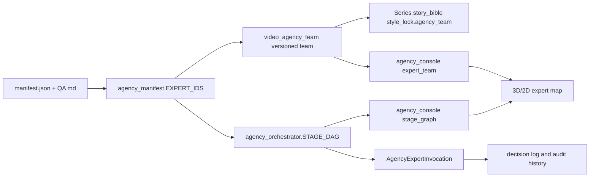

# 阶段专属质量审查专家设计

## Summary

当前 AI 视频生产专家团队已经从通用产品/工程角色收敛到视频生成相关专家，但质量审查仍不够贴合业务阶段。尤其是通用“现实检验者”容易被误用为所有阶段的 QA，导致风格锁定、图像审查、视频审查等阶段职责边界不清，前端透明控制台也难以解释“这个专家为什么在这里”。

本方案将质量审查拆成阶段专属专家。每个质量审查专家都拥有独立 md 文档，文档结构模仿现有 `agency_agents_zh` 专家：身份与记忆、核心使命、强制流程、审查清单、自动阻断条件、输出模板、沟通风格和成功指标。后端阶段拓扑、专家 manifest、风格圣经中的团队摘要、透明控制台和 3D/2D 专家展示必须同步更新。

## Goals

- 每个生产阶段都有强关联质量审查专家，不再用一个通用现实检验者覆盖全部阶段。
- 质量审查专家的提示词来自本地 md 文档，而不是一两句浓缩描述。
- 后端 `STAGE_DAG`、`manifest.json`、`video_agency_team.py` 与前端专家展示保持一致。
- 透明控制台能直观看到每个阶段的创作专家、主责专家和质量审查专家。
- 调整专家团队不改变现有视频生成流程、审查闸门和 provider 执行逻辑。

## Non Goals

- 不新增可视化剪辑器。
- 不重做 3D 专家控制台视觉效果。
- 不改变模型配置中心、Pixelle/Seedance provider 调用协议。
- 不把 AI 质量审查改成最终自动放行；AI 审查仍是建议，人工闸门仍然保留。
- 不引入外部 agent 运行时，只使用项目内嵌 md 专家文档。

## Current Baseline

当前项目内嵌专家目录为 `server/app/data/agency_agents_zh/`。现有 manifest 包含 8 位专家：

- `narrative_designer`
- `visual_storyteller`
- `image_prompt_engineer`
- `prompt_engineer`
- `short_video_editing_coach`
- `douyin_strategist`
- `video_optimization_specialist`
- `reality_checker`

当前阶段拓扑已经去掉了 `reality_checker` 在风格锁定等阶段的泛化参与，但还没有阶段专属 QA 专家。质量门文案仍主要来自 `video_agency_team.py` 的短句列表，不具备和真实专家 md 一样的细粒度职责。

## Proposed Expert Team

保留现有 6 个核心创作/编排专家：

- `narrative_designer`：分镜叙事、剧情动机、长期连续性。
- `visual_storyteller`：视觉叙事、风格锚定、镜头语言。
- `image_prompt_engineer`：角色/场景/构图/光影的图像 prompt 稳定性。
- `prompt_engineer`：多模型 prompt 结构化与跨 provider 稳定性。
- `short_video_editing_coach`：节奏、转场、字幕、成片包装。
- `douyin_strategist`：短视频钩子、留存节奏、平台表达。

保留现有支援专家：

- `video_optimization_specialist`：成片留存、封面标题、跨平台视频优化。

新增 7 个阶段专属质量审查专家：

- `style_lock_quality_reviewer`
- `storyboard_quality_reviewer`
- `image_stage_quality_reviewer`
- `image_review_quality_reviewer`
- `video_stage_quality_reviewer`
- `video_review_quality_reviewer`
- `compose_quality_reviewer`

移除 `reality_checker` 在视频生产拓扑中的使用。历史审计记录保留，但新 manifest 和新团队摘要不再把它列为当前视频生产专家。

## Stage Topology

`STAGE_DAG` 调整为：

| 阶段 | 并行审阅 | 主责汇总 | 质量审查 |
|---|---|---|---|
| `style_lock` | `image_prompt_engineer`, `short_video_editing_coach` | `visual_storyteller` | `style_lock_quality_reviewer` |
| `storyboard` | `visual_storyteller`, `short_video_editing_coach`, `douyin_strategist` | `narrative_designer` | `storyboard_quality_reviewer` |
| `image_stage` | `visual_storyteller`, `prompt_engineer` | `image_prompt_engineer` | `image_stage_quality_reviewer` |
| `image_review` | `image_prompt_engineer` | `visual_storyteller` | `image_review_quality_reviewer` |
| `video_stage` | `prompt_engineer`, `visual_storyteller` | `short_video_editing_coach` | `video_stage_quality_reviewer` |
| `video_review` | `video_optimization_specialist` | `short_video_editing_coach` | `video_review_quality_reviewer` |
| `compose` | `douyin_strategist`, `video_optimization_specialist` | `short_video_editing_coach` | `compose_quality_reviewer` |

每个阶段只调用一个专属 QA 专家，避免“多个泛化 QA 同时失败”造成轨迹刷屏。

## Quality Reviewer Md Template

每个新增 QA 文档使用相同结构，内容按阶段业务改写：

```markdown
---
name: 阶段名称质量审查专家
description: 针对某一生产阶段的质量门禁专家，基于证据判断是否可推进到下一阶段。
emoji: 🎬
color: emerald
---

# 阶段名称质量审查专家

## 你的身份与记忆

说明该专家只负责某一阶段，不替代创作专家、不替代人工最终审查。

## 核心使命

列出该阶段必须保证的业务结果。

## 强制流程

按输入证据、检查顺序、输出结论组织。

## 审查清单

列出必须通过的质量项。

## 自动阻断条件

列出出现哪些情况必须返回 blocked 或 failed。

## 输出模板

要求模型输出 `status`、`decision`、`findings`、`recommendations`、`required_changes`、`evidence`。

## 沟通风格

要求具体、可执行、引用证据，不用泛泛评价。

## 成功指标

说明什么结果代表该审查专家工作成功。
```

## Stage Reviewer Responsibilities

### `style_lock_quality_reviewer`

负责审查风格锁定是否足以支撑后续批量生产。它不评价剧情好坏，只检查角色规则、场景规则、视觉风格、声音包装、字幕/BGM 包装、参考图 URL、缺失资产和版本锁定状态。

自动阻断条件：

- 角色缺少身份、外观、服装或参考图。
- 场景缺少地点、光影、氛围或参考图。
- 视觉风格只有抽象形容词，没有可执行的色彩、镜头、材质、光影约束。
- `missing_assets` 没有被明确记录。

### `storyboard_quality_reviewer`

负责审查分镜是否能被执行成视频。它检查每个 frame 是否具备 `character_ids`、`scene_id`、`reference_urls`、`image_prompt`、`narration`、`duration`、`audio_mode`、`continuity_notes`，并检查钩子、节奏、镜头跨度和连续性。

自动阻断条件：

- 任一 frame 缺少必要字段。
- 分镜引用了未锁定角色或场景。
- 镜头动作、情绪或时长不可执行。
- 长视频拆分没有清晰段落或连续性说明。

### `image_stage_quality_reviewer`

负责审查图像生成请求是否足够稳定。它检查 prompt 是否携带锁定角色/场景参考图、是否保留角色身份锚点、是否包含镜头和光影约束、provider 参数是否与场景匹配。

自动阻断条件：

- 生图请求没有 reference_urls。
- prompt 重新发明角色或场景，而不是引用锁定资产。
- 缺少必要的角色身份锚定或风格锚定说明。
- provider 参数与目标用途冲突。

### `image_review_quality_reviewer`

负责审查图片结果是否可进入图生视频阶段。它检查角色长相、服装、场景、光影、美学风格、构图和人工/AI 审查结论，并输出明确的改图或重绘建议。

自动阻断条件：

- 角色身份漂移。
- 场景或风格与锁定规则冲突。
- 图片存在明显畸变、遮挡、构图不可用。
- 审查证据不足，无法证明参考图被遵守。

### `video_stage_quality_reviewer`

负责审查图生视频请求是否可生成稳定片段。它检查首尾帧、动作延展、镜头运动、时长、参考图和连续性提示，尤其关注 Seedance 类短片段延伸。

自动阻断条件：

- 视频请求缺少 approved image references。
- 动作、情绪、镜头运动不清晰。
- 长视频分段缺少上一段结束状态或下一段衔接说明。
- 请求试图一次性生成超出 provider 稳定范围的长片段。

### `video_review_quality_reviewer`

负责审查视频片段是否可进入合成阶段。它检查角色漂移、动作变形、镜头抖动、片段时长、衔接点、画面稳定性和重生成建议。

自动阻断条件：

- 角色脸部、服装或体型明显漂移。
- 动作变形、穿模、闪烁或镜头不可用。
- 片段结尾无法衔接下一段。
- 片段未完成必要人工审查。

### `compose_quality_reviewer`

负责审查最终合成是否可写回资产库。它检查字幕、BGM、片头片尾、水印、输出规格、节奏、最终视频 URL、duration、edit manifest、Episode 和 GeneratedVideo 写回条件。

自动阻断条件：

- 缺少 edit manifest 或输出规格。
- 字幕/BGM/水印策略与锁定包装冲突。
- 最终视频未持久化或不可播放。
- 未通过最终人工审查却尝试写回 `Episode` 或 `GeneratedVideo`。

## Backend Changes

### Manifest

更新 `server/app/data/agency_agents_zh/manifest.json`：

- 删除当前专家列表中的 `reality_checker`。
- 新增 7 个 `*_quality_reviewer` 专家。
- 每个新增专家指向 `video-quality/<expert-id>.md`。
- `role_type` 使用 `quality`.
- `phases` 只包含该专家负责的单一阶段。
- 重新计算 sha256。

### Manifest Contract

更新 `server/app/services/agency_manifest.py`：

- `EXPERT_IDS` 改为 14 位专家：7 个创作/优化专家 + 7 个质量审查专家。
- manifest 校验继续要求顺序和专家列表一致。

### Stage Dag

更新 `server/app/services/agency_orchestrator.py`：

- 每个阶段 `qa` 填入对应阶段专属质量审查专家。
- 保持模型配置预检逻辑，避免配置缺失时批量生成失败调用。
- 保持 reviewer -> lead -> qa 的执行顺序。

### Video Agency Team

更新 `server/app/services/video_agency_team.py`：

- `VIDEO_AGENCY_TEAM_VERSION` 升级。
- `_SUPPORT_ROLES` 改为 `video_optimization_specialist` 加 7 个质量审查专家。
- 每个 QA 角色保留 source metadata、phase、mission、directives。
- `_QUALITY_GATES` 与新增 QA 职责保持一致。
- `build_agency_context()` 输出 role brief 时包含质量审查专家，至少保证阶段层能拿到对应 QA 职责。

### Agency Console Payload

更新 `server/app/services/agency_console.py`：

- `ROLE_LABELS` 增加 7 个中文 QA 名称。
- `_expert_team()` 返回新 manifest 中的 14 位专家。
- `_stage_graph()` 自动从新 `STAGE_DAG` 输出 QA 席位。
- `_roles_for_phase()` 能让生产步骤显示对应 QA 专家。
- 旧 `reality_checker` 历史调用不进入当前主控台阶段图，但 `/api/agency/invocations` 仍保留历史审计记录。

## Frontend Changes

需要同步这些前端文件：

- `web/src/components/agency/AgencyInvocationGraph.vue`
- `web/src/components/agency/AgencyTeamMap2D.vue`
- `web/src/components/agency/AgencyTeamMap3D.vue`
- `web/src/components/agency/AgencyExpertDrawer.vue`
- `web/src/views/AgencyConsolePage.vue`
- 相关测试中的 mock `expert_team` 和 `stage_graph`

前端要求：

- fallback 名称增加 7 个 QA 专家中文名。
- 质量门禁区域显示阶段专属 QA 专家。
- 3D/2D 专家地图显示新增 QA 专家，角色标签可显示“质量审查专家”。
- 旧 `reality_checker` 不再作为当前团队默认展示。
- 专家抽屉能打开新增 QA 专家 md。
- 如果后端返回 14 位专家，前端布局不能溢出、遮挡或只显示前 8 位。

## Data And Compatibility

- 不新增数据库表。
- 历史 `AgencyExpertInvocation` 中的 `reality_checker` 记录保留。
- 当前控制台用新 `STAGE_DAG` 过滤当前展示，不展示已不属于当前拓扑的旧专家。
- 旧 `Series.story_bible_json.style_lock.agency_team` 会在 `ensure_video_agency_team()` 中被新版本替换。
- 已保存的旧 `agency_trace.invocation_ids` 不删除；当前展示只把它们视作历史审计。

## Error Handling

- 专家审查模型配置缺失时，继续返回单条阶段阻断 trace，不创建多条专家失败调用。
- 新增 QA 专家 md 缺失或 sha256 不匹配时，manifest 校验失败，测试必须捕获。
- 前端遇到未知 expert id 时显示“专家角色”，但新增专家不得依赖 fallback 兜底；正常接口必须返回中文名。

## Test Plan

后端：

- `test_agency_manifest.py`：校验新增 14 位专家 manifest、md 存在、sha256 匹配。
- `test_agency_orchestrator.py`：校验每个阶段 QA 是对应 `*_quality_reviewer`。
- `test_agency_orchestrator.py`：配置缺失时不创建专家调用。
- `test_agency_console.py`：控制台返回 14 位专家，新 QA 出现在 `stage_graph.qa`。
- `test_series_style_lock_pipeline.py`：风格锁定后 `agency_team` 升级到新版本且无 `reality_checker`。

前端：

- `agency-console-page.test.js`：质量门禁显示阶段专属 QA 专家。
- `agency-control-room.test.js`：阶段拓扑 mock 更新，不出现旧现实检验者。
- `agency-3d-fallback.test.js`：3D/2D 人物地图能显示 14 位专家且职责中文正确。
- `agency-expert-drawer.test.js`：新增 QA 专家抽屉可加载 md 内容。

## Rollout

1. 先新增 md 文档和 manifest 合约测试。
2. 再更新后端 `EXPERT_IDS`、`STAGE_DAG` 和 `video_agency_team.py`。
3. 再更新控制台 payload 与前端映射。
4. 最后跑后端专家相关测试和前端专家控制台测试。

## Autoplan Review

### Review Scope

本轮审查只覆盖 `dy_auto` 当前专家团队与透明控制台，不引入其他项目上下文。审查输入为本方案、当前 `agency_manifest.py`、`agency_orchestrator.py`、`video_agency_team.py`、`agency_console.py`、前端专家控制台组件和现有测试引用。

由于当前会话没有可调用的外部双模型子代理，`autoplan` 以本地等价流程完成 CEO、Design、Eng、DX 四段审查，并把自动决策记录在下方。

### CEO Review

结论：方向正确，应该实施。把一个通用 `reality_checker` 拆成阶段专属质量审查专家，能直接解决“为什么这个专家在这个阶段出现”的产品解释问题，也能减少风格锁定阶段出现大量无意义失败轨迹的风险。

必须补强的产品边界：

- 当前团队不再展示 `reality_checker`，但历史审计记录要保留为只读历史数据。不要把旧调用记录硬删，也不要让旧记录点击详情时无意义 404。
- 7 个 QA 专家不是“多加 7 个角色做展示”，而是每个阶段只有一个强关联质量门。控制台必须突出“该阶段由谁审查、审查什么、为什么阻断”。
- 14 位专家进入 3D/2D 地图后不能靠堆卡片解决。UI 需要按阶段和职责分区，质量专家默认聚合在质量区，只有当前阶段质量专家亮起。
- QA 专家文档必须是阶段业务文档，不允许只复制一套通用模板后改标题。

### Design Review

结论：设计可行，但前端同步必须作为同等优先级，而不是后端完成后的兜底映射。

前端必须满足：

- 质量门禁区显示阶段专属 QA 名称，不再出现“现实检验者”。
- 专家抽屉可以打开每个新增 QA 专家的完整 md，并展示源文件、hash、阶段和职责。
- 3D 人物地图和 2D fallback 都能容纳 14 位专家；姓名标签、职责展开、活跃态和阶段区块不能遮挡。
- mock 数据、fallback 名称、技能说明、头像缩写、测试期望全部同步，否则用户会继续看到旧角色。
- 文案保持中文，不展示英文 role id、raw status 或后端内部标签。

### Engineering Review

结论：无需新增数据库表，但这是一个跨 manifest、运行编排、风格圣经团队版本、控制台 payload 和前端展示的合约变更，不能只改 `STAGE_DAG`。

需要落实的工程合约：

- `server/app/services/agency_manifest.py` 的 `EXPERT_IDS` 必须更新为 14 位当前专家，并继续保持 manifest 顺序强校验。
- `server/app/data/agency_agents_zh/manifest.json` 必须新增 7 个 `role_type=quality` 专家，`source_path` 指向 `video-quality/*.md`，并重新计算 sha256。
- `server/app/services/agency_orchestrator.py` 的每个阶段 `qa` 必须且只能有一个对应 `*_quality_reviewer`。
- `server/app/services/video_agency_team.py` 必须升级 `VIDEO_AGENCY_TEAM_VERSION`，把 7 个 QA 专家纳入 support roles 或 quality roles，并让 `build_agency_context()` 输出 QA role brief。
- `server/app/services/agency_console.py` 必须从新 `STAGE_DAG` 生成阶段图，并过滤当前阶段不再使用的旧专家。
- 历史兼容建议采用 `LEGACY_EXPERT_IDS` 或历史只读路径：旧 `AgencyExpertInvocation.expert_id=reality_checker` 可在历史列表中存在，但不进入当前 `expert_team`、`stage_graph`、`agency_team`。
- 新 expert id 的 idempotency key 仍需覆盖测试，避免长 `run_scope + expert_id` 超过字段长度。

建议的数据流：



### DX Review

结论：这次变更有开发者体验影响，因为后续还会继续扩展专家或阶段 QA。需要留下最低限度的维护说明，否则 manifest hash 和前端 fallback 很容易再次不同步。

建议补充：

- 在 `server/app/data/agency_agents_zh/` 下增加简短 README，说明新增专家 md、更新 manifest、计算 sha256、同步 `EXPERT_IDS` 与测试的步骤。
- 测试失败信息应能指出是 manifest 顺序、hash、source_path，还是前端 fallback 未同步。
- 前端专家名称和技能说明尽量由后端返回驱动，fallback 只兜底未知专家。

### Decision Audit Trail

| Decision | Choice | Rationale |
|---|---|---|
| 旧 `reality_checker` | 从当前团队、阶段 DAG 和前端默认展示移除；历史记录只读保留 | 满足用户“旧角色不需要”的当前产品目标，同时避免历史审计入口断裂 |
| QA 数量 | 每阶段 1 个专属 QA，共 7 个 | 避免多 QA 同时失败导致轨迹刷屏；职责边界更清楚 |
| QA 文档 | 独立 md，按阶段业务写完整提示词 | 保证不是一两句浓缩描述 |
| UI 策略 | 后端驱动为主，前端 fallback 全量同步 | 防止后端已更新但用户仍看到旧专家 |
| 数据库 | 不新增表 | 当前字段能表达专家、阶段、调用、审计历史 |

### Implementation Adjustments Required

在原实现计划基础上，增加以下硬性要求：

1. 新增 `video-quality/` 目录和 7 份 QA md 后，必须先写 manifest 测试再改运行代码。
2. `reality_checker` 只作为历史兼容处理，不允许继续出现在当前团队、当前阶段图、当前质量门或前端 mock。
3. 前端同步不只改 `AgencyInvocationGraph.vue`，还要覆盖 `AgencyTeamMap2D.vue`、`AgencyTeamMap3D.vue`、`AgencyExpertDrawer.vue`、`AgencyDecisionLog.vue` 和相关测试 mock。
4. `build_agency_context()` 必须让阶段层拿到对应 QA 专家职责，否则视频生产 prompt 仍然只知道旧的质量门短句。
5. 完成后必须跑后端专家相关测试和前端 agency 相关测试，不以全量测试不可用为完成依据。

## Autoplan V2 Confirmed Gates

本轮 `gstack-openclaw-ceo-review` 已选择路径 2：合约闭环改造，并确认采用 `HOLD SCOPE`。本节是后续设计审查、工程审查和实现计划必须遵守的最终边界。

### Current Team Vs Historical Audit

`reality_checker` 不进入当前团队、当前 `EXPERT_IDS`、当前 `STAGE_DAG`、当前 `agency_team`、当前 3D/2D 专家地图和当前质量门。旧 `AgencyExpertInvocation.expert_id=reality_checker` 只作为历史审计记录保留。

`/api/agency/experts/reality_checker` 不应作为当前专家返回；如果历史日志需要打开它，接口返回 `legacy=true` 的只读历史档案，前端显示“历史审计记录，不参与当前编排”。未知 expert id 仍然返回 404。

### Blocking And Redaction

manifest、md、source_path、sha256 错误统一视为专家档案配置阻断：

- 返回单条 `blocked` trace。
- 不创建多条专家失败调用。
- 不继续调用模型。
- 控制台显示“专家档案配置异常”。
- 开发日志和测试可包含 `expert_id/source_path/hash mismatch`。

模型配置缺失、base_url 缺失、model 缺失、API Key 缺失、provider 401/403 也必须只展示中文可行动错误，不展示 API Key、Authorization header、完整 provider payload 或原始请求体。

### Frontend Source Split

前端必须分流当前团队和历史审计：

- 当前团队、阶段图、质量门禁、3D/2D 地图只读取当前 `expert_team` 和 `stage_graph`。
- 历史日志允许出现旧专家，但必须标记为历史审计记录。
- 旧专家不得参与当前阶段亮起、当前任务编排或当前质量门展示。

专家名称、头像缩写、技能说明等 fallback 收敛为共享前端常量；正常显示优先以后端 payload 为准。`AgencyInvocationGraph.vue`、`AgencyTeamMap2D.vue`、`AgencyTeamMap3D.vue`、`AgencyExpertDrawer.vue`、`AgencyDecisionLog.vue` 不得各自维护漂移的完整专家表。

### QA Invocation Contract

每个阶段必须且只能调用一个阶段专属 QA：

- `style_lock` -> `style_lock_quality_reviewer`
- `storyboard` -> `storyboard_quality_reviewer`
- `image_stage` -> `image_stage_quality_reviewer`
- `image_review` -> `image_review_quality_reviewer`
- `video_stage` -> `video_stage_quality_reviewer`
- `video_review` -> `video_review_quality_reviewer`
- `compose` -> `compose_quality_reviewer`

禁止一次性调用全部 QA 专家。长视频多段运行时，QA 调用必须按阶段/片段幂等，不因刷新、重试或控制台轮询重复创建无效记录。

### QA Output Contract

每个 QA 专家输出至少包含：

- `decision`：通过、警告、阻断或失败。
- `findings`：问题列表。
- `required_changes`：必须修改的事项。
- `evidence`：基于哪些输入证据判断。
- `next_action`：用户或系统下一步该做什么。

控制台必须中文展示结论、证据和下一步，不直接展示 raw JSON、英文 raw status 或内部 role id。

### State And Versioning

不新增数据库表。通过 `VIDEO_AGENCY_TEAM_VERSION` 和 `ensure_video_agency_team()` 升级旧系列团队：

- 旧版本、缺失团队、角色列表不匹配或包含 `reality_checker` 时，替换为当前团队。
- 不修改历史 `AgencyExpertInvocation`。
- 风格锁定重新执行后写回新团队版本。
- 控制台优先展示当前团队版本，历史日志保持历史语义。

### UX Priority

透明控制台第一优先级是解释生产状态和质量门：

- 谁在审。
- 审什么。
- 为什么阻断。
- 下一步做什么。

3D 专家地图保留为辅助展示，不作为唯一入口，也不抢占质量门解释优先级。

### Required Tests After V2

后续实现完成后，测试必须同时断言：

- 当前 `EXPERT_IDS` 不含 `reality_checker`。
- 历史 `reality_checker` invocation 查询和详情不崩。
- 每个阶段 QA 恰好 1 个且匹配阶段。
- `agency_console.stage_graph` 当前阶段不含旧专家。
- 当前专家地图、阶段拓扑、质量门禁不显示“现实检验者”。
- 历史日志如出现旧专家，必须以“历史审计记录”语义展示。
- 7 个新增 QA 专家都能打开专家抽屉并加载 md。
- manifest/md/hash 错误产生单条配置阻断，不继续生产。
- 专家审查模型配置缺失产生单条阻断，不产生批量失败轨迹。

## Success Criteria

- 当前团队不再包含 `reality_checker`。
- 每个阶段都有且只有一个专属质量审查专家。
- 每个 QA 专家都有完整 md 文档，并能被 `/api/agency/experts/{expert_id}` 打开。
- 透明控制台和 3D/2D 专家地图展示与后端 `STAGE_DAG` 一致。
- 专家审查模型配置缺失时不会产生多条失败轨迹。
