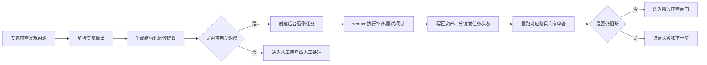

# 专家发现到自动返修闭环设计

## Summary

本方案补齐 AI 视频生产链路中的一个关键断点：专家团队现在已经能发现问题并写入透明决策日志，但这些发现还没有稳定转化为自动补齐、自动重试、自动复审和继续推进的后台任务。

本轮设计采用已确认的 **A 方案：自动补齐，但不自动放行**。系统会自动修复可确定、可验证的结构性问题，例如缺角色参考图、缺场景参考图、分镜字段缺失、生图失败、视频片段失败、provider timeout 等；但角色像不像、现实题材是否可信、控糖内容是否合规、最终观感是否满意等主观或高风险判断，仍然停在审查闸门，由人工或明确配置的质量审查通过后才能继续。

目标是让“一句话成片”不再因为可修复缺口卡死，同时保持后台透明、阶段可追踪、刷新页面不丢状态。

## Autoplan Review Corrections

2026-06-03 autoplan 审查后，本方案做出以下收紧：

- `ProductionJob` 当前没有 `job_type` 字段，自动返修第一版不得依赖不存在字段；返修任务使用 `ProductionJob.stage = "agency_auto_repair"` 或 `agency_auto_repair:<repair_type>`，并把完整 `repair_task` 快照放入 `payload_json`。
- 专家自然语言输出不能直接驱动返修执行；只有结构化 `repair_tasks` 或 classifier 白名单命中的确定性问题可以创建自动任务。
- 复审循环必须有硬上限。默认同一 `run/series/stage/target/type` 最多自动返修 2 轮，超过后转为 `manual_required`。
- 自动返修任务必须和 `AgencyExpertInvocation` 关联，前端展示时能从“专家发现”追到“返修 job”和“复审 invocation”。
- 返修 worker 必须复用已有 `ProductionJob` lease/idempotency、`ProductionAuditEvent`、provider stage task 和预算边界，不新增第二套队列。

## CEO Review Corrections

2026-06-04 CEO review 后，本方案补充一个产品级边界：**自动返修可以自动执行，但必须在用户已授权的生产策略内执行**。

- 一句话成片、系列批量生产或手动启动流水线时，必须展示并保存自动返修策略：是否启用自动返修、最大自动返修轮数、自动返修预算上限、允许自动返修的阶段。
- 默认策略为“自动补齐结构性缺口，不自动放行质量闸门”。若用户没有授权真实付费返修预算，系统只能生成返修建议和待执行任务，不能静默调用付费 provider。
- 每次自动返修消耗预算时，必须归因到对应 `repair_task`，前端显示“本次返修预计/已消耗成本”。
- 自动返修预算耗尽后，任务进入 `manual_required`，用户可以追加预算或手动处理。
- 这个授权不替代人工审查；它只允许系统在已批准成本范围内自动补齐确定性缺口。
- OpenClaw CEO review 后进一步补充：`manual_required` 不能只是技术状态，必须给用户一个明确的下一步动作；长视频场景下返修状态必须按阶段聚合展示，避免明细刷屏；每一次付费返修都必须形成可追踪的成本审计。

## Goals

- 将专家输出中的 `findings`、`required_changes`、`recommendations` 转化为结构化返修任务。
- 对确定性问题自动执行返修，例如补参考图、补分镜字段、重试失败帧、同步 provider 超时任务。
- 返修完成后自动重跑对应阶段专家审查，形成“发现 -> 返修 -> 复审”的闭环。
- 所有返修状态必须在专家控制台、角色资产、场景资产、审查中心和生产监控页可见。
- 自动返修不得绕过图像审查、视频审查、最终合成前审查和最终人工确认。
- 刷新页面、切换页面、worker 重启后仍可看到返修进度。
- 自动返修真实付费调用必须受用户授权的返修预算和轮数限制。

## Non Goals

- 不做可视化时间线剪辑器。
- 不做自动最终发布。
- 不让 AI 质量审查自动替代最终人工放行。
- 不在第一版引入复杂多 agent 外部运行时。
- 不把所有专家自然语言建议都强行自动执行。
- 不自动修复医疗、健康、真人肖像等高风险合规结论，只生成待审项和建议。

## Current Baseline

当前项目已经具备以下能力：

- `AgencyExpertInvocation` 能保存专家输出，包括 `decision`、`findings`、`required_changes`、`evidence`、`next_action`。
- `AgencyDecisionLog.vue` 能展示专家决策日志。
- 风格锁定已经是后台 job/worker 模式，并能记录 `style_lock.reference_progress`。
- 角色和场景参考图已有生成入口。
- 图像、视频、最终视频已有审查闸门和重绘/重试入口。
- `ProductionJob`、`ProductionSegment`、`VideoProductionAsset`、生产监控页已经承担部分阶段状态。

当前缺口：

- 专家发现只被展示和阻断，没有被统一解析成自动返修任务。
- 可自动修复问题和必须人工判断问题没有结构化分类。
- 返修任务没有统一入口、状态和审计格式。
- 前端无法看到“系统正在自动补什么”，用户只能看到问题或手动按钮。
- 返修后没有统一触发对应阶段复审。

## Design Principle

自动返修只处理 **可机器判断完成状态** 的问题。

自动返修还有一个前置条件：当前 run 或 series 必须有有效的 `auto_repair_policy`。没有策略时，classifier 仍可生成建议，但 orchestrator 不得创建真实付费返修任务。

可自动修：

- 缺角色参考图。
- 缺场景参考图。
- 分镜 frame 缺必填字段。
- `reference_urls`、`character_reference_urls`、`style_reference_urls` 缺失。
- 生图任务失败、超时、未同步。
- 视频片段任务失败、超时、未同步。
- provider task 已提交但前端 30 秒超时。
- 明确缺少已审核图片、首尾帧、上一段结束帧状态等结构性依赖。

不可自动放行：

- 角色不像。
- 脸部崩坏。
- 真人现实质感不足。
- 控糖、医疗、健康内容合规风险。
- 用户审美不满意。
- 镜头节奏是否符合最终表达。
- AI 审查和人工审查意见冲突。
- 最终视频是否可入库。

## Target Flow



## Repair Task Contract

专家运行结果增加结构化返修快照。第一版可以保存在 invocation output 和现有 job payload 中，不强制新建表。

```json
{
  "repairable": true,
  "manual_gate_required": true,
  "repair_tasks": [
    {
      "type": "missing_character_reference",
      "stage": "style_lock",
      "target_type": "character",
      "target_id": "character-id",
      "series_id": "series-id",
      "episode_id": null,
      "asset_id": null,
      "priority": "high",
      "auto_execute": true,
      "requires_paid_provider": true,
      "budget_authorized": true,
      "estimated_cost": 0.02,
      "reason": "角色缺少侧面和全身锚定参考图",
      "expected_result": "生成并写回角色参考图 URL，更新 reference_progress",
      "repair_action_label": "去角色资产补参考图",
      "repair_route": "/characters/character-id",
      "affected_ids": ["character-id"],
      "manual_gate_after_repair": true
    }
  ]
}
```

字段规则：

- `repairable` 表示这次专家发现中是否存在可自动修复项。
- `manual_gate_required` 表示返修后是否仍需人工或审查闸门确认。
- `type` 使用固定枚举，不允许直接执行任意自然语言。
- `auto_execute=true` 只允许用于白名单类型。
- `requires_paid_provider=true` 的任务必须校验 `auto_repair_policy` 和预算授权。
- `reason` 和 `expected_result` 面向用户展示，必须中文。
- `target_id` 必须能定位到现有系列、剧集、角色、场景、资产或片段。
- `repair_action_label` 是用户可见的下一步动作文案，必须使用中文，不允许显示 provider 或内部技术字段。
- `repair_route` 是前端可跳转的处理入口；`manual_required` 状态必须提供该字段。
- `affected_ids` 用于把用户从聚合状态定位到具体角色、场景、资产、分镜 frame 或视频 segment。

## Auto Repair Policy

自动返修策略是用户授权边界，保存到 run 或 series 关联的生产上下文中。第一版建议随 `ProductionPlan` 或 `VideoProductionRun.model_trace_json.auto_repair_policy` 保存快照，避免后续系列配置变化影响已启动任务。

```json
{
  "enabled": true,
  "max_rounds": 2,
  "budget_limit": 1.0,
  "currency": "CNY",
  "allowed_stages": ["style_lock", "storyboard", "image_stage", "video_stage", "compose"],
  "allowed_types": [
    "missing_character_reference",
    "missing_scene_reference",
    "storyboard_missing_references",
    "image_generation_timeout",
    "video_segment_timeout"
  ],
  "requires_human_gate_after_repair": true
}
```

规则：

- `enabled=false` 时只生成返修建议，不创建自动执行 job。
- `budget_limit` 只约束自动返修，不替代生产总预算。
- `max_rounds` 不能超过系统硬上限 2。
- `allowed_types` 不能包含主观质量、合规或最终放行类问题。
- 前端必须在启动生产前展示该策略摘要，用户确认后写入快照。

### 策略确认卡

一句话成片、系列批量生产和手动启动流水线前，前端必须展示“自动返修策略确认卡”：

- 是否启用自动返修。
- 最大自动返修轮数。
- 自动返修预算上限和币种。
- 允许自动返修的阶段。
- 允许自动执行的返修类型。
- 预算耗尽后的处理方式：停止自动返修并进入人工处理。

默认文案必须明确说明：自动返修只补齐结构性缺口，不代表最终画面、合规和成片质量已经通过。用户确认后，策略快照写入 run 上下文；后续 series 配置变化不能影响已启动 run 的返修授权。

## Repair Types

第一版支持以下类型：

| 类型 | 阶段 | 自动动作 | 返修后闸门 |
|---|---|---|---|
| `missing_character_reference` | 风格锁定 | 调用角色参考图生成，写回 `Character.avatar_*_url` 和 `meta_json.reference_generation` | 需要确认 |
| `missing_scene_reference` | 风格锁定 | 调用场景参考图生成，写回 `Scene.reference_*_url` 和 `meta_json.reference_generation` | 需要确认 |
| `storyboard_missing_fields` | 分镜脚本 | 补齐 frame 必填字段并写回 `Episode.storyboard_json` | 需要复审 |
| `storyboard_missing_references` | 分镜脚本 | 从角色/场景资产补齐 `reference_urls` | 需要复审 |
| `image_generation_failed` | 图像生成 | 重新排队失败帧，保留原失败记录 | 需要图像审查 |
| `image_generation_timeout` | 图像生成 | 切换为后台同步或重试 | 需要图像审查 |
| `image_missing_approved_asset` | 图像审查 | 生成待审图片或提示用户选择已有 approved asset | 需要人工确认 |
| `video_segment_failed` | 视频生成 | 重试当前 segment，不影响已完成 segment | 需要视频审查 |
| `video_segment_timeout` | 视频生成 | 后台同步 provider task 或重试 segment | 需要视频审查 |
| `compose_missing_approved_segments` | 合成交付 | 汇总缺失片段并回退到视频审查阶段 | 需要人工确认 |

不进入自动执行白名单的类型：

- `subjective_style_drift`
- `character_identity_not_convincing`
- `medical_or_health_compliance_risk`
- `realistic_quality_not_enough`
- `final_story_not_acceptable`
- `unsafe_or_policy_risk`

这些类型只生成审查建议和人工处理入口。

## Backend Architecture

新增或扩展以下服务边界：

### `agency_repair_classifier.py`

负责把专家输出转成结构化返修建议。

输入：

- `AgencyExpertInvocation.output_json`
- 当前 stage
- series、episode、run、asset、segment 的上下文

输出：

- `repair_tasks`
- `manual_gate_required`
- `blocked_reason`

要求：

- 优先消费专家输出中的结构化 `repair_tasks`。
- 如果专家输出仍是自然语言，只允许用规则匹配白名单问题，不允许自动执行模糊建议。
- 对无法定位 target 的任务标记为 `manual_required`，不自动执行。

### `agency_repair_orchestrator.py`

负责创建和调度返修任务。

职责：

- 去重同一 run、stage、target、type 的重复任务。
- 使用 `ProductionJob` 创建后台任务。
- 将任务写入当前对象的可见进度字段。
- 在任务完成后触发对应阶段复审。

### `agency_repair_executor.py`

负责执行具体返修动作。

职责：

- 调用 `reference_asset_service` 生成角色/场景参考图。
- 调用 director/auto-plan 或 storyboard repair helper 补分镜字段。
- 调用已有图像/视频 retry 或 provider sync 服务重试失败任务。
- 写入 `ProductionAuditEvent` 或等价审计事件。
- 失败时写清楚失败原因和下一步。

### State Reuse

第一版不强制新增 `ProductionRepairTask` 表，优先复用：

- `ProductionJob.stage = "agency_auto_repair"` 或 `agency_auto_repair:<repair_type>`。
- `ProductionJob.payload_json.repair_task` 保存任务快照。
- `ProductionJob.idempotency_key` 使用 `repair:{scope}:{stage}:{type}:{target_id}:{source_invocation_id}:{round}` 格式，避免重复 worker 或重复点击造成重复扣费。
- `Series.story_bible_json.style_lock.reference_progress` 展示风格锁定参考图进度。
- `Character.meta_json.reference_generation` 展示角色参考图进度。
- `Scene.meta_json.reference_generation` 展示场景参考图进度。
- `VideoProductionAsset.meta_json.repair_history` 展示图像/视频资产返修历史。
- `AgencyExpertInvocation.output_json.repair_tasks` 保存专家发现到返修任务的审计快照。

当返修任务量、并发和审计需求超过现有结构时，再升级独立 `ProductionRepairTask` 表。

## Stage Behavior

### 风格锁定

专家发现角色或场景参考图缺失时：

1. classifier 生成 `missing_character_reference` 或 `missing_scene_reference`。
2. orchestrator 创建后台返修任务。
3. executor 逐个生成参考图，写回角色/场景资产。
4. 前端角色资产库、场景资产库显示生成中、已完成、失败。
5. 全部可自动项完成后重跑 `style_lock_quality_reviewer`。
6. 通过后进入“等待确认风格锁定结果”，不自动替用户最终确认。

### 分镜脚本

专家发现 frame 缺字段时：

1. 自动补齐结构字段。
2. 对缺少 reference 的 frame，从锁定角色/场景资产补齐 URL。
3. 写回 `Episode.storyboard_json`。
4. 重跑 `storyboard_quality_reviewer`。
5. 如果仍然缺创作判断，例如镜头节奏不合理，则进入人工处理。

### 图像生成和图像审查

图像生成失败或超时时：

1. 后台重试失败帧或同步 provider task。
2. 生成新版本 asset，不覆盖旧版本。
3. 新 asset 进入图像审查。
4. 用户或配置好的审查流程确认后才能进入视频阶段。

图像审查发现主观质量问题时：

- 不自动通过。
- 可以自动生成一条“建议重绘”任务，但默认停在审查中心等待用户确认。

### 视频生成和视频审查

视频片段失败或超时时：

1. 只重试失败 segment。
2. 不重新生成已通过的视频 segment。
3. 成功后进入视频审查。
4. 视频审查通过后才能进入合成。

视频审查发现角色走样、动作变形、现实质感不足时：

- 不自动放行。
- 可生成重试建议和提示词修正建议。
- 是否重试由用户或明确配置的审查策略决定。

### 合成交付

合成前发现缺 approved segment：

1. 自动定位缺失 segment。
2. 回退到对应视频生成或视频审查状态。
3. 不允许直接合成。

最终视频写回 `Episode` 和 `GeneratedVideo` 仍必须经过最终人工确认。

## Frontend Transparency

前端必须展示三类状态：

1. 专家发现了什么。
2. 系统正在自动补什么。
3. 哪些仍需人工确认。

### 专家控制台

`AgencyDecisionLog.vue` 增加返修状态区：

- 发现：角色参考图缺失。
- 自动返修：正在生成老李侧面锚定图。
- 当前状态：排队中 / 生成中 / 已完成 / 失败。
- 复审状态：等待复审 / 复审通过 / 复审仍阻断。
- 人工闸门：需要确认 / 不需要。

### 系列详情页

风格锁定区域展示：

- 当前是否存在自动返修任务。
- 角色参考图补齐进度。
- 场景参考图补齐进度。
- 锁定按钮在锁定中或返修中不可重复点击。

### 角色资产和场景资产

每个角色/场景卡片展示：

- 参考图槽位状态。
- 自动生成来源。
- 最近返修原因。
- 查看原图入口。
- 失败时的重试入口。

### 审查中心

图像和视频审查列表展示：

- 自动重试生成的新版本。
- 原失败版本和新版本关系。
- 专家返修建议。
- 是否仍需人工批准。

### 生产监控页

生产树中增加“自动返修”节点，但不打断主流程视图：

- 返修节点归属到对应阶段。
- 展示任务数、成功数、失败数、等待人工数。
- 点击节点查看返修明细。
- 长视频和批量剧集默认按阶段聚合展示，不默认展开所有返修任务。
- 聚合状态至少展示：待返修、返修中、复审中、待人工、失败、已完成。
- 明细抽屉内再展示具体 `repair_task`、关联专家发现、受影响对象、预算消耗、下一步动作。

### 返修指标和成本审计

前端和后台监控至少需要记录以下指标：

- `repair_tasks_created`：返修任务创建数。
- `repair_tasks_completed`：返修任务完成数。
- `repair_tasks_failed`：返修任务失败数。
- `repair_tasks_manual_required`：转人工处理数。
- `repair_budget_estimated`：预计返修成本。
- `repair_budget_spent`：实际返修成本。
- `repair_provider_calls`：真实 provider 调用次数。

每一次付费返修必须能追踪到：专家发现、`repair_task`、`ProductionJob`、provider task、预算扣减记录、复审结果和最终人工闸门状态。

## Error Handling

- 自动返修最多重试固定次数，默认 2 次。
- 自动返修和复审合计最多 2 轮；同一问题连续两轮仍阻断后，必须进入 `manual_required`。
- 连续失败后任务进入 `manual_required`，不继续消耗 provider。
- provider timeout 不直接判失败，优先进入后台同步。
- 找不到 target 时不执行自动返修，只记录人工处理建议。
- 返修任务必须有 idempotency key，避免重复点击或重复 worker 导致重复扣费。
- 所有付费 provider 返修必须经过已有预算和 provider task 幂等边界。
- 任何 `manual_required` 都必须返回 `repair_action_label`、`repair_route` 和 `affected_ids`；如果无法生成处理入口，则显示“联系人工处理”，并记录缺失入口的审计事件。
- 预算耗尽、策略禁用、类型不在白名单、阶段不允许时，系统只能生成返修建议，不能创建真实付费 provider 任务。
- 复审通过只能推进到下一阶段闸门，不允许跳过图像审查、视频审查、合成前审查和最终人工确认。

## Security And Cost Guard

- 不把专家自然语言直接作为执行命令。
- 不把专家自然语言中的 URL、文件路径、shell 命令或 provider 参数直接传入执行器。
- 不允许专家输出任意 URL 写入资产库，必须走现有存储和可用性校验。
- 所有真实 provider 返修都必须走模型配置中心和预算限制。
- 所有真实付费返修必须先校验 `auto_repair_policy.enabled`、`allowed_types`、`allowed_stages`、`max_rounds` 和剩余返修预算。
- 用户提供的 API Key 不进入日志、专家输出和前端决策日志。
- 医疗、健康、真人肖像风险只允许生成审查建议，不允许自动放行。

## API Shape

第一版建议新增或扩展：

### `GET /api/agency/repair-tasks`

查询某个 series/run/stage 的返修任务。

请求参数：

- `series_id`
- `episode_id`
- `run_id`
- `stage`

返回：

```json
{
  "items": [
    {
      "id": "job-id",
      "type": "missing_character_reference",
      "stage": "style_lock",
      "status": "running",
      "reason": "角色缺少侧面参考图",
      "expected_result": "生成并写回角色参考图",
      "manual_gate_after_repair": true,
      "created_at": "2026-06-03T00:00:00Z",
      "updated_at": "2026-06-03T00:00:00Z"
    }
  ]
}
```

### `POST /api/agency/repair-tasks/worker-step`

后台 worker 执行返修任务。

### `POST /api/agency/repair-tasks/{job_id}/retry`

仅用于失败后人工触发重试。

### Existing API Extension

以下接口返回值增加 `repair_summary`：

- `GET /api/series/{series_id}/style-lock`
- `GET /api/series/{series_id}/agency-console`
- `GET /api/video-production/runs/{run_id}`
- 审查中心资产列表接口

## Testing

后端测试：

- 专家输出缺角色参考图时，生成 `missing_character_reference` repair task。
- 专家输出主观风格问题时，不生成自动执行任务。
- 返修任务能调用参考图生成服务，并写回角色资产。
- 返修任务能补齐 storyboard frame 的 `reference_urls`。
- 图像失败帧只重试失败帧，不影响已通过资产。
- 视频失败 segment 只重试当前 segment。
- 返修完成后触发对应阶段专家复审。
- 重复 worker step 不会创建重复 provider 任务。
- 付费 provider 返修会经过预算和 provider task 幂等保护。
- `auto_repair_policy.enabled=false` 时只生成返修建议，不创建自动执行 job。
- 预算耗尽时任务进入 `manual_required`，并返回中文处理入口。
- 同一付费返修能追踪到专家发现、provider task、预算扣减和复审 invocation。

前端测试：

- 专家决策日志显示“发现、自动返修、复审、人工闸门”。
- 风格锁定中和返修中按钮不可重复点击。
- 角色资产、场景资产显示参考图槽位生成进度。
- 审查中心能看到自动返修生成的新版本。
- 生产监控页显示返修节点和失败原因。
- 启动生产前展示自动返修策略确认卡，并能保存策略快照。
- 长视频 run 的返修节点默认聚合展示，点击后再展开明细。
- `manual_required` 项展示明确中文动作入口，并能跳转到对应页面。
- 用户面向文案保持中文，不暴露 provider 技术字段。

## Rollout

### Phase 1: 分类和展示

- 增加 repair classifier。
- 在专家 invocation 中保存 `repair_tasks` 快照。
- 前端专家控制台展示返修建议，但不执行自动返修。

### Phase 2: 风格锁定自动补齐

- 支持角色和场景参考图缺失的自动补齐。
- 接入 style-lock worker。
- 角色/场景资产库展示进度。

### Phase 3: 分镜和图像阶段返修

- 支持分镜字段补齐。
- 支持失败图像帧重试。
- 审查中心展示新旧版本关系。

### Phase 4: 视频片段和合成前返修

- 支持失败视频 segment 重试。
- 支持合成前缺 approved segment 的回退。
- 生产监控页展示返修节点。

### Phase 5: 稳定性和成本保护

- 增加返修任务幂等、预算保护、失败降级和后台同步。
- 增加真实 provider smoke 的返修路径验证。

## Success Criteria

- 用户发起一句话成片后，可自动补齐缺失角色/场景参考图。
- 专家发现结构性缺口后，前端能看到自动返修进度。
- 自动返修完成后，对应阶段会自动复审。
- 可自动修复的问题不会再只停留为一段日志。
- 主观质量和最终放行仍然需要人工或明确审查通过。
- 页面刷新后仍能看到返修状态。
- 不产生重复 provider 提交和重复扣费。
- 用户在生产启动前能看到并确认自动返修策略。
- 每个需要人工处理的返修项都有明确中文下一步入口。
- 长视频返修状态默认聚合展示，不因大量 segment 任务造成页面刷屏。
- 每一次付费返修都能追踪到成本、provider 调用和复审结果。

## Open Risks

- 专家输出如果不稳定，classifier 必须以白名单规则兜底，不能盲信自然语言。
- 复审可能再次生成返修任务，需要限制循环次数。
- 长视频场景下返修任务量大，前端必须按阶段聚合展示，不能全量刷屏。
- 真实 provider 失败原因复杂，第一版应优先保证状态可见和可恢复，而不是强行自动修好所有失败。
- 如果自动返修策略确认卡设计不清晰，用户仍会觉得后台在暗箱操作；实施计划必须把该确认卡作为第一阶段交付物。
- 如果 `manual_required` 没有明确动作入口，自动返修闭环会退化成另一种日志展示；实施时必须把处理入口作为接口契约校验项。

## Final Decision

本方案采用 **自动补齐，但不自动放行**。自动返修负责消除可确定的生产断点，审查闸门负责守住主观质量、合规风险和最终入库边界。

## GSTACK REVIEW REPORT

| Review | Trigger | Why | Runs | Status | Findings |
|--------|---------|-----|------|--------|----------|
| CEO Review | `/autoplan` | Scope & strategy | 1 | CLEAR | 边界正确：自动补齐但不自动放行，符合一句话成片闭环和人工闸门目标。 |
| Design Review | `/autoplan` | UI/UX gaps | 1 | CLEAR | 需要在专家控制台、系列详情、角色资产、场景资产、审查中心和生产监控页同时展示返修状态，方案已覆盖。 |
| Eng Review | `/autoplan` | Architecture & tests | 1 | CLEAR WITH CORRECTIONS | 发现 `ProductionJob.job_type` 不存在，已修订为使用 `ProductionJob.stage` 和 `payload_json.repair_task`；同时补充复审循环上限和结构化白名单约束。 |
| DX Review | `/autoplan` | Developer experience gaps | 1 | SKIPPED | 本方案面向产品后台和用户可见生产流程，不新增开发者 API/CLI 入门体验。 |

**NOT in scope:** 不建设可视化时间线、抖音发布、自动最终放行、外部 agent 运行时或独立返修任务表第一版。

**What already exists:** 复用 `AgencyExpertInvocation`、`ProductionJob`、`ProductionAuditEvent`、style-lock worker、reference progress、图像/视频审查闸门、provider stage task、预算和幂等边界。

**Architecture diagram:**

```text
AgencyExpertInvocation
  -> agency_repair_classifier
  -> agency_repair_orchestrator
  -> ProductionJob(stage=agency_auto_repair, payload_json.repair_task)
  -> agency_repair_executor
  -> existing services:
       reference_asset_service
       director/storyboard repair
       production_retry_service
       provider_stage_executor / worker sync
  -> ProductionAuditEvent
  -> stage-specific AgencyOrchestrator re-review
  -> human review gate
```

**Test diagram:**

| Codepath | Test expectation |
|---|---|
| Expert output has structured `missing_character_reference` | Creates one deduped repair job and writes visible progress. |
| Expert output has only subjective style complaint | Creates manual suggestion only, no auto job. |
| Duplicate worker step | Reuses idempotency key and does not create duplicate provider task. |
| Style-lock repair completes | Reruns `style_lock_quality_reviewer` and stays at confirmation gate. |
| Storyboard missing references | Repairs `Episode.storyboard_json` and reruns storyboard review. |
| Image/video failure repair | Creates new version only for affected frame or segment. |
| Repair loop exceeds 2 rounds | Marks `manual_required` and stops paid provider consumption. |

**Failure modes registry:**

| Failure mode | Severity | Required mitigation |
|---|---|---|
| Expert natural language is vague but classifier over-matches | Critical | Use fixed enum whitelist and target validation before auto execution. |
| Repair task repeats after worker restart | High | Use deterministic `repair:{scope}:{stage}:{type}:{target}:{source_invocation}:{round}` idempotency key. |
| Re-review creates infinite repair loop | High | Hard cap 2 automatic repair rounds per issue. |
| Provider retry duplicates paid task | Critical | Route paid repair through provider stage task and budget reservation boundaries. |
| UI shows issue but not repair progress | Medium | Add `repair_summary` to agency console, style-lock, run, and review APIs. |

**Cross-phase themes:** Product, design and engineering reviews agree that the feature is valuable only if it is transparent and bounded. The key implementation guard is not “repair everything”, but “repair deterministic structure, then stop at review gates”.

**VERDICT:** Spec cleared after corrections. Ready for implementation-plan writing.
